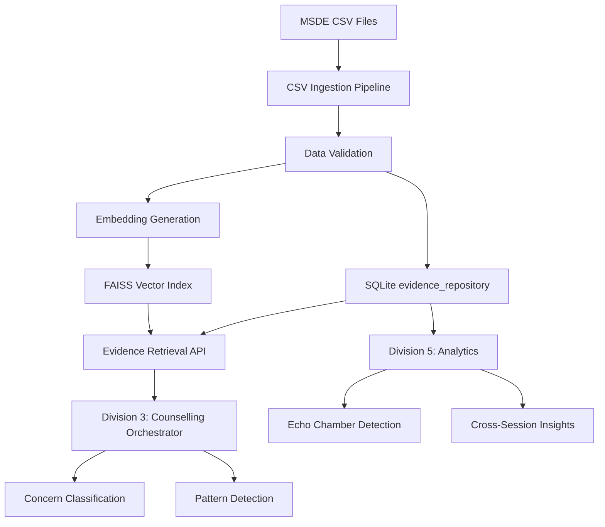
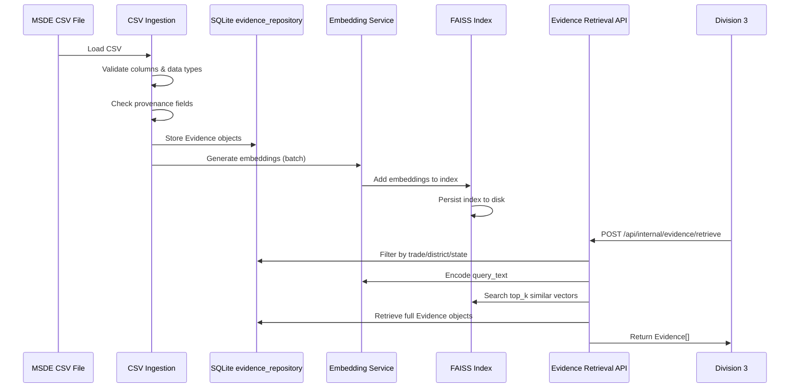

# Design Document: Division 2 - RAG Pipeline & Evidence Retrieval

## Overview

### Purpose

Division 2 implements the Evidence Repository and Retrieval Service for the PS 26241 AI-Enabled Career Counselling Platform. This service is responsible for ingesting verified MSDE (Ministry of Skill Development and Entrepreneurment) outcome data from CSV files, validating and storing evidence with provenance tracking, generating semantic embeddings using sentence-transformers, creating and managing a FAISS vector store, and providing filtered evidence retrieval with semantic search capabilities.

The enhanced Evidence schema extends the baseline API contract v1.2 to support five critical real-world scenarios:
1. **Reality Check**: Physical demands, typical workday descriptions, and trainee quotes with verified sources
2. **Gender Context**: Female enrollment percentages and safety infrastructure details
3. **Echo Chamber Detection**: Data that enables Division 5 analytics to detect repetitive concern patterns
4. **Guardian Veto Detection**: Speaker-tagged evidence that helps Division 3 identify guardian resistance
5. **Provenance Tracking**: Complete data lineage for all evidence components

Division 2 operates as a **data layer** - it provides structured, filtered, and ranked evidence but does not perform intelligence operations like concern classification, echo chamber detection, or guardian veto analysis. These responsibilities belong to Division 3 (Counselling Orchestrator) and Division 5 (Analytics).

### Key Design Principles

1. **Provenance-First**: All evidence requires data_source and data_period; trainee quotes require trainee_quote_source
2. **No Hardcoded Thresholds**: Division 2 returns all relevant evidence; downstream services interpret thresholds
3. **Backward Compatibility**: Enhanced schema is strictly additive - all API contract v1.2 fields remain unchanged
4. **Async Operations**: Support 50+ concurrent retrieval requests using async SQLAlchemy and aiosqlite
5. **Semantic Search**: FAISS vector similarity combined with structured filtering for precise retrieval
6. **Data Quality**: Validation at ingestion, runtime checks, and statistics endpoints for monitoring

### Architecture Context



## Architecture

### System Components

Division 2 consists of four primary components:

#### 1. CSV Ingestion Pipeline (`app/services/csv_ingestion.py`)
- Reads MSDE outcome data CSV files
- Validates required columns and data types
- Parses progression_path JSON arrays
- Validates provenance fields (data_source, data_period, trainee_quote_source)
- Creates Evidence objects with enhanced schema
- Logs data quality warnings for missing provenance or malformed rows

#### 2. Embedding Service (`app/services/embedding_service.py`)
- Loads sentence-transformers model 'all-MiniLM-L6-v2' (384-dimensional embeddings)
- Generates text representations from Evidence fields
- Batch encodes evidence records (batch size 32)
- Normalizes embeddings to unit length for cosine similarity
- Handles model unavailability with HTTP 503 responses

#### 3. FAISS Index Manager (`app/services/faiss_manager.py`)
- Creates and manages FAISS IndexFlatIP (inner product index for cosine similarity)
- Maintains mapping between FAISS index positions and evidence_id values
- Persists index to disk: `backend/data/faiss_index.bin`
- Persists mapping to disk: `backend/data/index_mapping.json`
- Loads index and mapping on startup
- Provides rebuild_index functionality for full re-indexing

#### 4. Evidence Retrieval Service (`app/services/evidence_retrieval.py`)
- Accepts filtering criteria: trade, district, state, concern_category, concern_intent
- Queries SQLite for candidate evidence_ids matching filters
- Encodes query_text to embedding (if provided)
- Searches FAISS index for top_k similar vectors among filtered candidates
- Retrieves full Evidence objects from SQLite
- Returns ranked Evidence array with enhanced schema fields

### Data Flow



### Technology Stack

- **Web Framework**: FastAPI (async endpoints)
- **Database**: SQLite with aiosqlite driver and async SQLAlchemy
- **Embedding Model**: sentence-transformers `all-MiniLM-L6-v2` (384-dim vectors)
- **Vector Store**: FAISS IndexFlatIP (cosine similarity via inner product on normalized vectors)
- **CSV Parsing**: Python csv module with UTF-8 encoding
- **Schema Validation**: Pydantic v2 models

### Scalability Considerations

**Current Design (< 100,000 records)**:
- FAISS IndexFlatIP provides exact search with O(n) complexity
- Acceptable for datasets up to 100,000 evidence records
- Average retrieval latency: < 100ms

**Future Migration Path (> 100,000 records)**:
- Migrate to FAISS IndexIVFFlat with 100 clusters
- Approximate nearest neighbor search with O(√n) complexity
- Training step required: cluster centroids from evidence embeddings
- Trade-off: 95%+ recall with 10x speed improvement

**Concurrent Request Handling**:
- Async SQLAlchemy with connection pooling (StaticPool for SQLite)
- FAISS index loaded in memory (shared read-only access)
- Target: 50+ concurrent requests without performance degradation
- SQLite WAL mode enables concurrent reads during writes

## Components and Interfaces

### 1. CSV Ingestion Module

**Module**: `app/services/csv_ingestion.py`

**Responsibility**: Parse MSDE CSV files and create validated Evidence objects

**Key Functions**:

```python
async def ingest_csv(file_path: str) -> tuple[int, int, list[str]]:
    """
    Ingest MSDE outcome data from CSV file.
    
    Args:
        file_path: Path to CSV file
        
    Returns:
        Tuple of (success_count, error_count, error_messages)
    """
```

**CSV Schema**:
```
Required columns:
- evidence_id (VARCHAR 50)
- trade (VARCHAR 100)
- district (VARCHAR 100)
- state (VARCHAR 100)
- data_source (VARCHAR 200) 
- data_period (VARCHAR 50)

Optional columns:
- placement_rate (VARCHAR 20)
- earnings_min (INTEGER)
- earnings_max (INTEGER)
- currency (VARCHAR 10)
- nsqf_level (VARCHAR 50)
- progression_path (JSON array string)
- physical_demand (TEXT)
- typical_day (TEXT)
- trainee_quote (TEXT)
- trainee_quote_source (TEXT)
- female_enrollment_pct (VARCHAR 10)
- safety_infrastructure (TEXT)
```

**Validation Rules**:
1. Required columns must exist
2. earnings_min <= earnings_max
3. placement_rate format: "XX%" or NULL
4. progression_path must be valid JSON array or NULL
5. If trainee_quote exists, trainee_quote_source must exist (else set trainee_quote to NULL and log warning)
6. evidence_id must be unique

**Error Handling**:
- Log row number and error details for malformed rows
- Skip invalid rows and continue processing
- Return summary: (success_count, error_count, error_messages)

### 2. Embedding Service

**Module**: `app/services/embedding_service.py`

**Responsibility**: Generate semantic embeddings for evidence text

**Key Functions**:

```python
class EmbeddingService:
    def __init__(self):
        """Initialize sentence-transformers model."""
        self.model = SentenceTransformer('all-MiniLM-L6-v2')
        
    def generate_text_representation(self, evidence: Evidence) -> str:
        """
        Create text representation from Evidence fields.
        
        Includes: trade, district, state, placement_rate, earnings range,
        nsqf_level, physical_demand, typical_day, trainee_quote.
        """
        
    async def encode_batch(self, texts: list[str]) -> np.ndarray:
        """
        Batch encode texts to embeddings (384-dim).
        
        Args:
            texts: List of text representations
            
        Returns:
            Normalized embeddings array (shape: [n, 384])
        """
        
    async def encode_single(self, text: str) -> np.ndarray:
        """Encode single text to normalized embedding."""
```

**Text Representation Format**:
```
Trade: {trade}
Location: {district}, {state}
Placement Rate: {placement_rate}
Earnings: {earnings_min}-{earnings_max} {currency}
NSQF Level: {nsqf_level}
Physical Demand: {physical_demand}
Typical Day: {typical_day}
Trainee Experience: {trainee_quote}
```

**Normalization**:
- All embeddings normalized to unit length: ||v|| = 1
- Enables cosine similarity via inner product: cos(θ) = v1 · v2

### 3. FAISS Index Manager

**Module**: `app/services/faiss_manager.py`

**Responsibility**: Create, persist, and manage FAISS vector index

**Key Functions**:

```python
class FAISSManager:
    def __init__(self, index_path: str, mapping_path: str):
        """Initialize FAISS manager with file paths."""
        
    async def initialize(self):
        """Load existing index and mapping or create new empty index."""
        
    async def add_embeddings(
        self, 
        evidence_ids: list[str], 
        embeddings: np.ndarray
    ):
        """
        Add embeddings to FAISS index.
        
        Args:
            evidence_ids: List of evidence_id values
            embeddings: Normalized embedding array (shape: [n, 384])
        """
        
    async def search(
        self, 
        query_embedding: np.ndarray, 
        top_k: int,
        candidate_ids: Optional[list[str]] = None
    ) -> list[tuple[str, float]]:
        """
        Search FAISS index for similar vectors.
        
        Args:
            query_embedding: Normalized query vector (shape: [384])
            top_k: Number of results to return
            candidate_ids: Optional filter - only search these evidence_ids
            
        Returns:
            List of (evidence_id, similarity_score) tuples, ranked by score
        """
        
    async def rebuild_index(self, evidence_records: list[Evidence]):
        """
        Rebuild FAISS index from scratch.
        
        Deletes existing index, regenerates embeddings, recreates index.
        """
        
    async def persist(self):
        """Save FAISS index and mapping to disk."""
```

**Index Structure**:
- **Type**: IndexFlatIP (exact inner product search)
- **Dimension**: 384
- **Metric**: Inner product (equivalent to cosine similarity on normalized vectors)
- **Persistence**: Binary format via `faiss.write_index()`

**Mapping Structure** (`index_mapping.json`):
```json
{
  "0": "EV001",
  "1": "EV002",
  "2": "EV003"
}
```
Maps FAISS index position (integer) to evidence_id (string).

### 4. Evidence Retrieval Service

**Module**: `app/services/evidence_retrieval.py`

**Responsibility**: Orchestrate filtering, semantic search, and evidence retrieval

**Key Functions**:

```python
async def retrieve_evidence(
    db: AsyncSession,
    trade: Optional[str] = None,
    district: Optional[str] = None,
    state: Optional[str] = None,
    concern_category: Optional[str] = None,
    concern_intent: Optional[str] = None,
    query_text: Optional[str] = None,
    top_k: int = 5
) -> list[Evidence]:
    """
    Retrieve filtered and ranked evidence.
    
    Process:
    1. Filter by trade/district/state in SQLite (if provided)
    2. Encode query_text to embedding (if provided)
    3. Search FAISS for top_k similar vectors among filtered candidates
    4. Retrieve full Evidence objects from SQLite
    5. Return ranked Evidence array
    
    Args:
        db: Async database session
        trade: Optional trade filter
        district: Optional district filter
        state: Optional state filter
        concern_category: Optional concern category (currently unused, reserved for future)
        concern_intent: Optional concern intent (currently unused, reserved for future)
        query_text: Optional semantic search query
        top_k: Number of results to return (default 5)
        
    Returns:
        List of Evidence objects with enhanced schema fields
    """
```

**Retrieval Algorithm**:

1. **Filtering Phase**:
   ```sql
   SELECT evidence_id FROM evidence_repository
   WHERE (trade = ? OR ? IS NULL)
     AND (district = ? OR ? IS NULL)
     AND (state = ? OR ? IS NULL)
   ```

2. **Semantic Search Phase** (if query_text provided):
   - Encode query_text to 384-dim embedding
   - Search FAISS index restricted to filtered candidate_ids
   - Rank by cosine similarity score (descending)

3. **Fallback Ordering** (if no query_text):
   - Order by placement_rate DESC (prefer higher placement rates)

4. **Retrieval Phase**:
   ```sql
   SELECT * FROM evidence_repository
   WHERE evidence_id IN (?)
   ORDER BY ranking from FAISS or placement_rate
   ```

**Gender Context Priority** (Requirement 6):
- When `concern_category == "gender_family"`:
  - Filter candidates to records with non-NULL `female_enrollment_pct` AND `safety_infrastructure`
  - Still rank by semantic relevance (FAISS similarity)
  - Do NOT apply arbitrary thresholds (e.g., "female_enrollment_pct > 20%")

### 5. REST API Endpoints

**Module**: `app/routers/evidence.py`

#### POST /api/internal/evidence/retrieve

**Request Schema**:
```python
class EvidenceRetrieveRequest(BaseModel):
    trade: Optional[str] = None
    district: Optional[str] = None
    state: Optional[str] = None
    concern_category: Optional[str] = None
    concern_intent: Optional[str] = None
    query_text: Optional[str] = None
    top_k: int = Field(default=5, ge=1, le=20)
```

**Response Schema**:
```python
class EvidenceRetrieveResponse(BaseModel):
    evidence: list[Evidence]
```

**Status Codes**:
- 200: Success (empty array if no matches)
- 422: Validation error
- 500: Database error
- 503: Embedding model unavailable

#### POST /api/internal/evidence/rebuild_index

**Purpose**: Administrative endpoint to trigger full FAISS index rebuild

**Request Schema**: None (POST with empty body)

**Response Schema**:
```python
class RebuildIndexResponse(BaseModel):
    message: str
    evidence_count: int
    rebuild_time_seconds: float
```

**Status Codes**:
- 200: Rebuild successful
- 500: Rebuild failed

#### GET /api/internal/evidence/stats

**Purpose**: Monitoring endpoint for evidence repository statistics

**Response Schema**:
```python
class EvidenceStatsResponse(BaseModel):
    total_evidence_count: int
    trades_covered: int
    districts_covered: int
    evidence_with_reality_check_count: int
    evidence_with_gender_data_count: int
```

**Status Codes**:
- 200: Success

## Data Models

### Enhanced Evidence Schema

**Pydantic Model**: `app/schemas/evidence.py`

```python
class RealityCheck(BaseModel):
    """Reality check data with verified provenance."""
    physical_demand: Optional[str] = None
    typical_day: Optional[str] = None
    trainee_quote: Optional[str] = None
    trainee_quote_source: Optional[str] = None
    
    @field_validator('trainee_quote')
    @classmethod
    def validate_trainee_quote_source(cls, v, info):
        """If trainee_quote exists, trainee_quote_source must exist."""
        if v and not info.data.get('trainee_quote_source'):
            return None  # Clear trainee_quote if source is missing
        return v


class Evidence(BaseModel):
    """Enhanced Evidence schema (backward-compatible with API contract v1.2)."""
    
    # Required fields (API contract v1.2)
    evidence_id: str = Field(max_length=50)
    trade: str = Field(max_length=100)
    district: str = Field(max_length=100)
    state: str = Field(max_length=100)
    data_source: str = Field(max_length=200)
    data_period: str = Field(max_length=50)
    
    # Optional fields (API contract v1.2)
    placement_rate: Optional[str] = Field(None, max_length=20)
    earnings_min: Optional[int] = None
    earnings_max: Optional[int] = None
    currency: Optional[str] = Field(None, max_length=10)
    nsqf_level: Optional[str] = Field(None, max_length=50)
    progression_path: Optional[list[str]] = None
    
    # Enhanced fields (Division 2 extensions)
    reality_check: Optional[RealityCheck] = None
    female_enrollment_pct: Optional[str] = Field(None, max_length=10)
    safety_infrastructure: Optional[str] = None
    
    # Metadata
    created_at: Optional[datetime] = None
    
    @field_validator('earnings_min', 'earnings_max')
    @classmethod
    def validate_earnings_range(cls, v, info):
        """Validate earnings_min <= earnings_max."""
        if 'earnings_min' in info.data and 'earnings_max' in info.data:
            min_val = info.data['earnings_min']
            max_val = info.data['earnings_max']
            if min_val and max_val and min_val > max_val:
                raise ValueError('earnings_min must be <= earnings_max')
        return v
    
    @field_validator('placement_rate')
    @classmethod
    def validate_placement_rate_format(cls, v):
        """Validate placement_rate format: 'XX%' or NULL."""
        if v and not re.match(r'^\d+%$', v):
            raise ValueError('placement_rate must be in format "XX%"')
        return v
```

### SQLite Database Schema

**Table**: `evidence_repository`

```sql
CREATE TABLE evidence_repository (
    evidence_id VARCHAR(50) PRIMARY KEY,
    trade VARCHAR(100) NOT NULL,
    district VARCHAR(100) NOT NULL,
    state VARCHAR(100) NOT NULL,
    placement_rate VARCHAR(20),
    earnings_min INTEGER,
    earnings_max INTEGER,
    currency VARCHAR(10),
    data_source VARCHAR(200) NOT NULL,
    data_period VARCHAR(50) NOT NULL,
    nsqf_level VARCHAR(50),
    progression_path JSON,
    
    -- Reality check fields
    physical_demand TEXT,
    typical_day TEXT,
    trainee_quote TEXT,
    trainee_quote_source TEXT,
    
    -- Gender context fields
    female_enrollment_pct VARCHAR(10),
    safety_infrastructure TEXT,
    
    -- Internal fields
    embedding_text TEXT,
    created_at TIMESTAMP DEFAULT CURRENT_TIMESTAMP
);

CREATE INDEX idx_evidence_trade ON evidence_repository(trade);
CREATE INDEX idx_evidence_district ON evidence_repository(district);
CREATE INDEX idx_evidence_state ON evidence_repository(state);
CREATE INDEX idx_evidence_gender ON evidence_repository(female_enrollment_pct, safety_infrastructure);
```

**SQLAlchemy Model**: `app/models/evidence.py`

```python
class EvidenceModel(Base):
    """SQLAlchemy model for evidence_repository table."""
    __tablename__ = "evidence_repository"
    
    evidence_id = Column(String(50), primary_key=True)
    trade = Column(String(100), nullable=False)
    district = Column(String(100), nullable=False)
    state = Column(String(100), nullable=False)
    placement_rate = Column(String(20))
    earnings_min = Column(Integer)
    earnings_max = Column(Integer)
    currency = Column(String(10))
    data_source = Column(String(200), nullable=False)
    data_period = Column(String(50), nullable=False)
    nsqf_level = Column(String(50))
    progression_path = Column(JSON)
    
    # Reality check fields
    physical_demand = Column(Text)
    typical_day = Column(Text)
    trainee_quote = Column(Text)
    trainee_quote_source = Column(Text)
    
    # Gender context fields
    female_enrollment_pct = Column(String(10))
    safety_infrastructure = Column(Text)
    
    # Internal fields
    embedding_text = Column(Text)
    created_at = Column(DateTime, default=datetime.utcnow)
```

### FAISS Index Schema

**Index Type**: `faiss.IndexFlatIP`

**Properties**:
- Dimension: 384
- Metric: Inner Product (IP)
- Normalized vectors: cosine similarity = inner product

**Mapping File**: `backend/data/index_mapping.json`

```json
{
  "version": "1.0",
  "total_records": 1247,
  "last_updated": "2026-10-15T14:30:00Z",
  "mapping": {
    "0": "EV001",
    "1": "EV002"
  }
}
```

### Integration with API Contract v1.2

Division 2 extends the Evidence schema from API contract v1.2 while maintaining **strict backward compatibility**:

**Original Fields (unchanged)**:
- evidence_id, trade, district, state
- placement_rate, earnings_min, earnings_max, currency
- data_source, data_period
- nsqf_level, progression_path

**Enhanced Fields (additive)**:
- reality_check (object with physical_demand, typical_day, trainee_quote, trainee_quote_source)
- female_enrollment_pct (string)
- safety_infrastructure (string)

Division 3 can safely ignore enhanced fields if not needed. Pydantic validation ensures schema compliance before returning evidence to consumers.


## Correctness Properties

*A property is a characteristic or behavior that should hold true across all valid executions of a system—essentially, a formal statement about what the system should do. Properties serve as the bridge between human-readable specifications and machine-verifiable correctness guarantees.*

### Property Reflection

After analyzing all acceptance criteria, I identified the following testable properties and performed reflection to eliminate redundancy:

**CSV Ingestion & Schema Properties:**
- Properties 1.2, 1.10, 5.9 all validate provenance fields (data_source, data_period) → **Combine into single property**
- Property 1.7 and 5.3 both validate trainee_quote provenance → **Already combined in requirements**
- Property 1.9 (storage round-trip) subsumes schema validation → **Keep as comprehensive property**

**Filtering Properties:**
- Property 4.3 (filter conjunction) and 4.4 (no-filter baseline) are complementary → **Keep both**
- Property 6.6 (gender context priority) is a specialized filter → **Keep separate**

**Embedding Properties:**
- Property 2.2 and 2.3 both test text representation → **Combine into comprehensive property**
- Property 2.7 (batch equivalence) is distinct from individual encoding → **Keep separate**

**Schema Validation Properties:**
- Property 7.1 (v1.2 fields) and 7.2 (optional enhanced fields) test schema structure → **Combine**
- Property 7.5 (validation occurs) and 7.6 (invalid excluded) test validation enforcement → **Combine**

**Persistence Properties:**
- Property 3.3 (FAISS persistence) and 3.4 (mapping persistence) are both round-trips → **Keep separate** (different data structures)

### Property 1: Provenance Completeness

*For any* Evidence object created from CSV ingestion or stored in the database, the fields `data_source` and `data_period` SHALL be non-NULL.

**Validates: Requirements 1.10, 5.9**

### Property 2: Trainee Quote Provenance Validation

*For any* Evidence object with a `trainee_quote` field, if the quote is non-NULL then `trainee_quote_source` SHALL also be non-NULL. If `trainee_quote` exists but `trainee_quote_source` is missing, `trainee_quote` SHALL be set to NULL.

**Validates: Requirements 1.7, 5.3, 5.4**

### Property 3: Required Column Validation

*For any* CSV file provided to the ingestion pipeline, if the file is missing any required columns (`evidence_id`, `trade`, `district`, `state`, `data_source`, `data_period`), the validation SHALL fail and no records SHALL be ingested.

**Validates: Requirements 1.2**

### Property 4: Earnings Range Validation

*For any* Evidence object, if both `earnings_min` and `earnings_max` are non-NULL, then `earnings_min` SHALL be less than or equal to `earnings_max`.

**Validates: Requirements 10.2**

### Property 5: Progression Path Round-Trip

*For any* JSON array of strings representing a progression path, serializing to a string and then parsing SHALL produce an equivalent array.

**Validates: Requirements 1.4**

### Property 6: Optional Field NULL Handling

*For any* CSV row with missing optional fields, the resulting Evidence object SHALL have NULL values for those fields, and the Evidence SHALL pass Pydantic validation.

**Validates: Requirements 1.5, 7.2**

### Property 7: Enhanced Schema Structure

*For any* Evidence object, the schema SHALL include all original fields from API contract v1.2 AND all enhanced fields (`reality_check`, `female_enrollment_pct`, `safety_infrastructure`), with enhanced fields marked as optional.

**Validates: Requirements 1.8, 6.1, 6.2, 7.1, 7.2**

### Property 8: Evidence Storage Round-Trip

*For any* Evidence object stored in the SQLite evidence_repository, retrieving the record by `evidence_id` SHALL produce an equivalent Evidence object with all fields matching the original.

**Validates: Requirements 1.9**

### Property 9: Text Representation Completeness

*For any* Evidence object, the generated text representation SHALL include all non-NULL fields: `trade`, `district`, `state`, `placement_rate`, earnings range, `nsqf_level`, and if present, `physical_demand`, `typical_day`, and `trainee_quote`.

**Validates: Requirements 2.2, 2.3**

### Property 10: Embedding Normalization

*For any* embedding vector generated by the embedding service, after normalization the vector's L2 norm SHALL equal 1.0 (unit length): ||v|| = 1.

**Validates: Requirements 2.5**

### Property 11: Batch Encoding Equivalence

*For any* list of text representations, batch encoding the list SHALL produce embeddings equivalent to encoding each text individually: `batch_encode(texts)` == `[encode(t) for t in texts]`.

**Validates: Requirements 2.7**

### Property 12: Index Position Mapping Consistency

*For any* embedding added to the FAISS index at position `i` with `evidence_id` = `E`, the index-to-evidence mapping SHALL satisfy `mapping[i] == E`.

**Validates: Requirements 3.2**

### Property 13: FAISS Index Persistence Round-Trip

*For any* FAISS index saved to disk and then reloaded, searching the reloaded index with the same query vector SHALL produce identical results (same evidence_ids in same order) as the original index.

**Validates: Requirements 3.3**

### Property 14: Index Mapping JSON Round-Trip

*For any* index-to-evidence mapping saved to JSON and then reloaded, the reloaded mapping SHALL be equivalent to the original: `save(mapping) → load() == mapping`.

**Validates: Requirements 3.4**

### Property 15: Index Rebuild Equivalence

*For any* evidence dataset, rebuilding the FAISS index from scratch SHALL produce search results equivalent to the original index for the same queries.

**Validates: Requirements 3.8**

### Property 16: Filter Conjunction (Subset Property)

*For any* evidence dataset and filtering parameters, the result set from filtering by `(trade AND district)` SHALL be a subset of (or equal to) the result set from filtering by `trade` alone. More generally, adding additional filters SHALL never increase the result set size.

**Validates: Requirements 4.3**

### Property 17: No-Filter Baseline

*For any* evidence dataset, retrieving with no filtering parameters (trade=None, district=None, state=None) SHALL consider all evidence records as candidates (subject to top_k limit).

**Validates: Requirements 4.4**

### Property 18: Similarity Ranking Order

*For any* retrieval with `query_text` provided, the returned evidence SHALL be ordered by similarity score descending. For any two consecutive results at positions i and j where i < j, `similarity_score[i]` SHALL be greater than or equal to `similarity_score[j]`.

**Validates: Requirements 4.5**

### Property 19: Placement Rate Fallback Ordering

*For any* retrieval without `query_text`, the returned evidence SHALL be ordered by `placement_rate` descending (after parsing "XX%" to numeric value).

**Validates: Requirements 4.6**

### Property 20: Retrieved Evidence Schema Completeness

*For any* evidence returned by the retrieval endpoint, the Evidence object SHALL include all API contract v1.2 fields AND all enhanced fields, even if enhanced fields are NULL.

**Validates: Requirements 4.7, 4.8**

### Property 21: Gender Context Filtering Priority

*For any* retrieval request with `concern_category == "gender_family"`, the candidate evidence SHALL be filtered to records where both `female_enrollment_pct` IS NOT NULL AND `safety_infrastructure` IS NOT NULL, before applying semantic ranking. No arbitrary threshold filtering shall be applied to enrollment percentage values.

**Validates: Requirements 6.6, 6.7**

### Property 22: Female Enrollment Percentage Format

*For any* Evidence object with non-NULL `female_enrollment_pct`, the value SHALL match the pattern "XX%" where XX is a numeric value.

**Validates: Requirements 6.3**

### Property 23: Gender Data NULL Handling

*For any* Evidence object where gender-related data does not exist in the source, `female_enrollment_pct` and `safety_infrastructure` SHALL be set to NULL.

**Validates: Requirements 6.5**

### Property 24: Evidence Validation Enforcement

*For any* Evidence object returned by the retrieval endpoint, the object SHALL pass Pydantic schema validation. If validation fails during retrieval, that evidence SHALL be excluded from results and an error SHALL be logged.

**Validates: Requirements 7.5, 7.6**

### Property 25: Malformed Row Recovery

*For any* CSV file containing a mix of valid and malformed rows, the ingestion pipeline SHALL process all valid rows successfully and skip only the malformed rows, logging each error with row number.

**Validates: Requirements 9.1**

### Property 26: Partial Results Handling

*For any* retrieval request with `top_k = K` where the total number of matching evidence records is N < K, the endpoint SHALL return all N available results without error.

**Validates: Requirements 9.5**

### Property 27: Placement Rate Format Validation

*For any* `placement_rate` value in ingested CSV data, the value SHALL either match the pattern "XX%" (where XX is numeric) or be NULL. Invalid formats SHALL cause validation failure for that row.

**Validates: Requirements 10.1**

### Property 28: Evidence ID Uniqueness

*For any* attempt to insert an Evidence object with a duplicate `evidence_id`, the database SHALL reject the insertion with a uniqueness constraint violation.

**Validates: Requirements 10.3**


## Error Handling

### Error Categories

Division 2 handles four categories of errors with distinct recovery strategies:

#### 1. Data Quality Errors (Recoverable)

**Scenarios**:
- Malformed CSV rows (invalid data types, missing required fields)
- Invalid JSON in progression_path field
- Missing provenance (trainee_quote without trainee_quote_source)
- Duplicate evidence_id values
- Earnings range violations (min > max)

**Handling Strategy**:
- Log detailed error with row number/evidence_id and field name
- Skip the problematic row/record
- Continue processing remaining data
- Return summary: (success_count, error_count, error_messages)

**Example**:
```python
try:
    evidence = parse_csv_row(row)
    validate_evidence(evidence)
    await store_evidence(evidence)
    success_count += 1
except ValidationError as e:
    logger.warning(f"Row {row_num} validation failed: {e}")
    error_messages.append(f"Row {row_num}: {e}")
    error_count += 1
    continue  # Skip this row
```

#### 2. Service Unavailability Errors (Non-Recoverable)

**Scenarios**:
- Embedding model not loaded (sentence-transformers initialization failure)
- Database connection failure
- FAISS index corrupted and cannot be recreated

**Handling Strategy**:
- Return HTTP 503 Service Unavailable with descriptive error message
- Log critical error with stack trace
- For FAISS corruption: attempt to create new empty index; if that fails, service is degraded

**Example**:
```python
try:
    embedding = await embedding_service.encode(text)
except ModelNotLoadedError:
    logger.error("Embedding model unavailable")
    raise HTTPException(
        status_code=503,
        detail="embedding model unavailable"
    )
```

#### 3. Database Errors (Retriable)

**Scenarios**:
- Transient database connection errors
- Database lock timeouts (SQLite)
- Query execution failures

**Handling Strategy**:
- Return HTTP 500 Internal Server Error with message "database error"
- Log error with query details
- SQLite WAL mode reduces lock contention
- Retry logic at application layer for transient failures (up to 3 retries with exponential backoff)

**Example**:
```python
@retry(stop=stop_after_attempt(3), wait=wait_exponential(multiplier=1, min=1, max=10))
async def query_evidence_with_retry(db: AsyncSession, filters: dict):
    try:
        return await query_evidence(db, filters)
    except OperationalError as e:
        logger.error(f"Database query failed: {e}")
        if "database is locked" in str(e):
            raise  # Trigger retry
        else:
            raise HTTPException(status_code=500, detail="database error")
```

#### 4. Validation Errors (Client Error)

**Scenarios**:
- Invalid request parameters (negative top_k, empty evidence_id)
- Invalid filtering values
- Malformed JSON in request body

**Handling Strategy**:
- Return HTTP 422 Unprocessable Entity with Pydantic validation details
- Log warning with request details
- No retry - client must fix request

**Example**:
```python
class EvidenceRetrieveRequest(BaseModel):
    top_k: int = Field(default=5, ge=1, le=20)  # Pydantic validates range
    
# FastAPI automatically returns 422 for validation failures
```

### Error Response Formats

**503 Service Unavailable**:
```json
{
  "detail": "embedding model unavailable"
}
```

**500 Internal Server Error**:
```json
{
  "detail": "database error"
}
```

**422 Validation Error**:
```json
{
  "detail": [
    {
      "loc": ["body", "top_k"],
      "msg": "ensure this value is greater than or equal to 1",
      "type": "value_error.number.not_ge"
    }
  ]
}
```

### Logging Strategy

**Log Levels**:
- **INFO**: Successful operations (CSV ingestion completion, index rebuild, retrieval requests)
- **WARNING**: Data quality issues (missing provenance, invalid formats, skipped rows)
- **ERROR**: Service failures (model unavailable, database errors, FAISS corruption)
- **CRITICAL**: System initialization failures (database schema creation, model loading)

**Log Format**:
```
%(asctime)s - %(name)s - %(levelname)s - %(message)s
```

**Performance Metrics Logging**:
```python
logger.info(
    f"Evidence retrieval: filters={filters}, query_text_provided={bool(query_text)}, "
    f"candidates={len(candidate_ids)}, results={len(evidence)}, "
    f"embedding_time={embed_time_ms}ms, faiss_time={faiss_time_ms}ms, "
    f"db_time={db_time_ms}ms, total_time={total_time_ms}ms"
)
```

### FAISS Index Corruption Recovery

When FAISS index file is corrupted:

1. **Detection**: Index loading fails with deserialization error
2. **Log Error**: Log critical error with file path and error details
3. **Recovery**: Delete corrupted index file and mapping
4. **Rebuild**: Create new empty index
5. **Notification**: Log warning that index is empty and requires rebuild via `/rebuild_index` endpoint
6. **Service Status**: Service remains operational with empty index (returns empty results)

```python
try:
    self.index = faiss.read_index(index_path)
    logger.info(f"FAISS index loaded from {index_path}")
except Exception as e:
    logger.error(f"FAISS index corrupted: {e}")
    logger.warning("Creating new empty index")
    os.remove(index_path)
    os.remove(mapping_path)
    self.index = faiss.IndexFlatIP(384)
    self.mapping = {}
```

## Testing Strategy

### Overview

Division 2 testing uses a **dual approach**:

1. **Property-Based Tests**: Verify universal properties across randomly generated inputs (100+ iterations)
2. **Unit Tests**: Verify specific examples, edge cases, and integration points
3. **Integration Tests**: Verify database operations, API endpoints, and external dependencies

### Property-Based Testing

**Library**: `hypothesis` for Python

**Configuration**:
- Minimum 100 iterations per property test
- Use `@given` decorators with custom strategies
- Tag each test with design property reference

**Tag Format**:
```python
# Feature: division-2-rag-evidence-retrieval, Property 8: Evidence Storage Round-Trip
```

#### Custom Generators

**Evidence Generator**:
```python
@composite
def evidence_strategy(draw):
    """Generate random Evidence objects with valid schema."""
    return Evidence(
        evidence_id=draw(st.text(min_size=1, max_size=50, alphabet=st.characters(whitelist_categories=('Lu', 'Ll', 'Nd')))),
        trade=draw(st.sampled_from(["Electrician", "Solar Technician", "Plumber", "Welder"])),
        district=draw(st.sampled_from(["Nashik", "Pune", "Mumbai", "Nagpur"])),
        state=draw(st.sampled_from(["Maharashtra", "Karnataka", "Gujarat"])),
        placement_rate=draw(st.one_of(st.none(), st.integers(min_value=0, max_value=100).map(lambda x: f"{x}%"))),
        earnings_min=draw(st.one_of(st.none(), st.integers(min_value=5000, max_value=50000))),
        earnings_max=draw(st.one_of(st.none(), st.integers(min_value=5000, max_value=100000))),
        currency=draw(st.just("INR")),
        data_source=draw(st.just("MSDE Outcome Dataset")),
        data_period=draw(st.just("2024-25")),
        nsqf_level=draw(st.one_of(st.none(), st.sampled_from(["Level 3", "Level 4", "Level 5"]))),
        progression_path=draw(st.one_of(st.none(), st.lists(st.text(min_size=1, max_size=20), min_size=1, max_size=5))),
        reality_check=draw(st.one_of(st.none(), reality_check_strategy())),
        female_enrollment_pct=draw(st.one_of(st.none(), st.integers(min_value=0, max_value=100).map(lambda x: f"{x}%"))),
        safety_infrastructure=draw(st.one_of(st.none(), st.text(min_size=10, max_size=200)))
    )
```

#### Property Test Examples

**Property 1: Provenance Completeness**
```python
# Feature: division-2-rag-evidence-retrieval, Property 1: Provenance Completeness
@given(evidence=evidence_strategy())
@settings(max_examples=100)
def test_provenance_completeness(evidence):
    """For any Evidence, data_source and data_period SHALL be non-NULL."""
    assert evidence.data_source is not None
    assert evidence.data_period is not None
```

**Property 8: Evidence Storage Round-Trip**
```python
# Feature: division-2-rag-evidence-retrieval, Property 8: Evidence Storage Round-Trip
@given(evidence=evidence_strategy())
@settings(max_examples=100)
async def test_evidence_storage_round_trip(evidence, db_session):
    """For any Evidence stored and retrieved, all fields SHALL match original."""
    # Store
    await store_evidence(db_session, evidence)
    
    # Retrieve
    retrieved = await get_evidence_by_id(db_session, evidence.evidence_id)
    
    # Verify equivalence
    assert retrieved == evidence
```

**Property 16: Filter Conjunction (Subset Property)**
```python
# Feature: division-2-rag-evidence-retrieval, Property 16: Filter Conjunction
@given(
    evidence_list=st.lists(evidence_strategy(), min_size=10, max_size=50),
    trade=st.sampled_from(["Electrician", "Solar Technician"]),
    district=st.sampled_from(["Nashik", "Pune"])
)
@settings(max_examples=100)
async def test_filter_conjunction_subset(evidence_list, trade, district, db_session):
    """Filtering by (trade AND district) SHALL return subset of filtering by trade alone."""
    # Store evidence
    for evidence in evidence_list:
        await store_evidence(db_session, evidence)
    
    # Retrieve with trade filter only
    results_trade = await retrieve_evidence(db_session, trade=trade)
    
    # Retrieve with trade AND district filter
    results_both = await retrieve_evidence(db_session, trade=trade, district=district)
    
    # Verify subset relationship
    assert len(results_both) <= len(results_trade)
    both_ids = {e.evidence_id for e in results_both}
    trade_ids = {e.evidence_id for e in results_trade}
    assert both_ids.issubset(trade_ids)
```

**Property 18: Similarity Ranking Order**
```python
# Feature: division-2-rag-evidence-retrieval, Property 18: Similarity Ranking Order
@given(
    evidence_list=st.lists(evidence_strategy(), min_size=10, max_size=20),
    query_text=st.text(min_size=10, max_size=100)
)
@settings(max_examples=100)
async def test_similarity_ranking_order(evidence_list, query_text, db_session, embedding_service, faiss_manager):
    """Results SHALL be ordered by similarity score descending."""
    # Store evidence and build index
    for evidence in evidence_list:
        await store_evidence(db_session, evidence)
    await faiss_manager.rebuild_index(evidence_list)
    
    # Retrieve with query
    results = await retrieve_evidence(
        db_session,
        query_text=query_text,
        top_k=5
    )
    
    # Compute similarity scores
    query_embedding = await embedding_service.encode_single(query_text)
    scores = []
    for evidence in results:
        text_repr = embedding_service.generate_text_representation(evidence)
        evidence_embedding = await embedding_service.encode_single(text_repr)
        score = np.dot(query_embedding, evidence_embedding)
        scores.append(score)
    
    # Verify descending order
    for i in range(len(scores) - 1):
        assert scores[i] >= scores[i + 1], f"Ranking violation: score[{i}]={scores[i]} < score[{i+1}]={scores[i+1]}"
```

### Unit Testing

**Purpose**: Test specific examples, edge cases, and integration points

**Framework**: `pytest` with `pytest-asyncio`

#### Unit Test Examples

**CSV Ingestion - Valid File**
```python
async def test_csv_ingestion_valid_file():
    """Ingest valid CSV file with all required columns."""
    csv_path = "tests/fixtures/valid_evidence.csv"
    success_count, error_count, errors = await ingest_csv(csv_path)
    
    assert error_count == 0
    assert success_count == 10
    assert len(errors) == 0
```

**CSV Ingestion - Missing Required Columns**
```python
async def test_csv_ingestion_missing_columns():
    """CSV missing required columns should fail validation."""
    csv_path = "tests/fixtures/missing_columns.csv"
    success_count, error_count, errors = await ingest_csv(csv_path)
    
    assert success_count == 0
    assert error_count > 0
    assert any("required column" in e for e in errors)
```

**Trainee Quote Provenance Validation**
```python
async def test_trainee_quote_without_source_sets_null():
    """Trainee quote without source should be set to NULL with warning logged."""
    evidence = Evidence(
        evidence_id="TEST001",
        trade="Electrician",
        district="Nashik",
        state="Maharashtra",
        data_source="MSDE",
        data_period="2024-25",
        reality_check=RealityCheck(
            trainee_quote="Great experience",
            trainee_quote_source=None  # Missing source
        )
    )
    
    # Validate and clean
    validated = validate_and_clean_evidence(evidence)
    
    # Trainee quote should be NULL
    assert validated.reality_check.trainee_quote is None
```

**Gender Context Filtering**
```python
async def test_gender_context_filtering_priority(db_session):
    """When concern_category is gender_family, prioritize evidence with gender data."""
    # Create evidence mix: some with gender data, some without
    evidence_with_gender = Evidence(
        evidence_id="G001",
        trade="Electrician",
        district="Nashik",
        state="Maharashtra",
        data_source="MSDE",
        data_period="2024-25",
        female_enrollment_pct="35%",
        safety_infrastructure="24/7 CCTV"
    )
    
    evidence_without_gender = Evidence(
        evidence_id="G002",
        trade="Electrician",
        district="Nashik",
        state="Maharashtra",
        data_source="MSDE",
        data_period="2024-25",
        female_enrollment_pct=None,
        safety_infrastructure=None
    )
    
    await store_evidence(db_session, evidence_with_gender)
    await store_evidence(db_session, evidence_without_gender)
    
    # Retrieve with gender_family concern
    results = await retrieve_evidence(
        db_session,
        concern_category="gender_family",
        trade="Electrician",
        district="Nashik"
    )
    
    # Should only include evidence with gender data
    assert len(results) == 1
    assert results[0].evidence_id == "G001"
```

**Empty Results Handling**
```python
async def test_retrieve_no_matches_returns_empty_array(db_session):
    """When no evidence matches filters, return empty array with HTTP 200."""
    results = await retrieve_evidence(
        db_session,
        trade="NonexistentTrade",
        district="NonexistentDistrict"
    )
    
    assert results == []
    assert isinstance(results, list)
```

### Integration Testing

**Purpose**: Verify database operations, API endpoints, FAISS persistence

**Framework**: `pytest` with `httpx.AsyncClient` for API testing

#### Integration Test Examples

**End-to-End Retrieval API**
```python
async def test_retrieve_evidence_endpoint(client: AsyncClient, db_session):
    """Test POST /api/internal/evidence/retrieve endpoint."""
    # Setup: Store test evidence
    evidence = create_test_evidence()
    await store_evidence(db_session, evidence)
    
    # Request
    response = await client.post(
        "/api/internal/evidence/retrieve",
        json={
            "trade": "Electrician",
            "district": "Nashik",
            "top_k": 5
        }
    )
    
    # Verify
    assert response.status_code == 200
    data = response.json()
    assert "evidence" in data
    assert isinstance(data["evidence"], list)
    
    # Verify schema
    for evidence in data["evidence"]:
        assert "evidence_id" in evidence
        assert "trade" in evidence
        assert "reality_check" in evidence  # Enhanced field present
```

**FAISS Index Rebuild**
```python
async def test_rebuild_index_endpoint(client: AsyncClient, db_session):
    """Test POST /api/internal/evidence/rebuild_index endpoint."""
    # Setup: Store test evidence
    for i in range(10):
        evidence = create_test_evidence(evidence_id=f"TEST{i:03d}")
        await store_evidence(db_session, evidence)
    
    # Rebuild index
    response = await client.post("/api/internal/evidence/rebuild_index")
    
    # Verify
    assert response.status_code == 200
    data = response.json()
    assert "evidence_count" in data
    assert data["evidence_count"] == 10
    assert "rebuild_time_seconds" in data
```

**Database Schema Validation**
```python
async def test_evidence_repository_schema_exists(db_session):
    """Verify evidence_repository table has correct schema."""
    # Query table schema
    result = await db_session.execute(text("PRAGMA table_info(evidence_repository)"))
    columns = result.fetchall()
    
    column_names = [col[1] for col in columns]
    
    # Verify required columns
    assert "evidence_id" in column_names
    assert "trade" in column_names
    assert "district" in column_names
    assert "state" in column_names
    assert "data_source" in column_names
    assert "data_period" in column_names
    
    # Verify enhanced columns
    assert "physical_demand" in column_names
    assert "trainee_quote" in column_names
    assert "trainee_quote_source" in column_names
    assert "female_enrollment_pct" in column_names
    assert "safety_infrastructure" in column_names
```

**FAISS Persistence Verification**
```python
async def test_faiss_index_persistence(faiss_manager, db_session):
    """Verify FAISS index can be saved and reloaded with equivalent results."""
    # Create test evidence and build index
    evidence_list = [create_test_evidence(evidence_id=f"TEST{i:03d}") for i in range(20)]
    for evidence in evidence_list:
        await store_evidence(db_session, evidence)
    await faiss_manager.rebuild_index(evidence_list)
    
    # Search before persistence
    query_embedding = np.random.rand(384).astype('float32')
    query_embedding = query_embedding / np.linalg.norm(query_embedding)
    results_before = await faiss_manager.search(query_embedding, top_k=5)
    
    # Save and reload
    await faiss_manager.persist()
    faiss_manager_reloaded = FAISSManager(
        index_path="backend/data/faiss_index.bin",
        mapping_path="backend/data/index_mapping.json"
    )
    await faiss_manager_reloaded.initialize()
    
    # Search after reload
    results_after = await faiss_manager_reloaded.search(query_embedding, top_k=5)
    
    # Verify equivalence
    assert len(results_before) == len(results_after)
    for i in range(len(results_before)):
        assert results_before[i][0] == results_after[i][0]  # Same evidence_id
        assert abs(results_before[i][1] - results_after[i][1]) < 1e-6  # Same score
```

### Test Coverage Goals

- **Line Coverage**: > 85%
- **Branch Coverage**: > 80%
- **Property Test Coverage**: All 28 correctness properties
- **Integration Test Coverage**: All API endpoints, database operations, FAISS persistence

### Testing Execution

**Run all tests**:
```bash
pytest tests/ -v
```

**Run property-based tests only**:
```bash
pytest tests/property/ -v --hypothesis-show-statistics
```

**Run with coverage**:
```bash
pytest tests/ --cov=app --cov-report=html
```

**Run integration tests**:
```bash
pytest tests/integration/ -v
```

