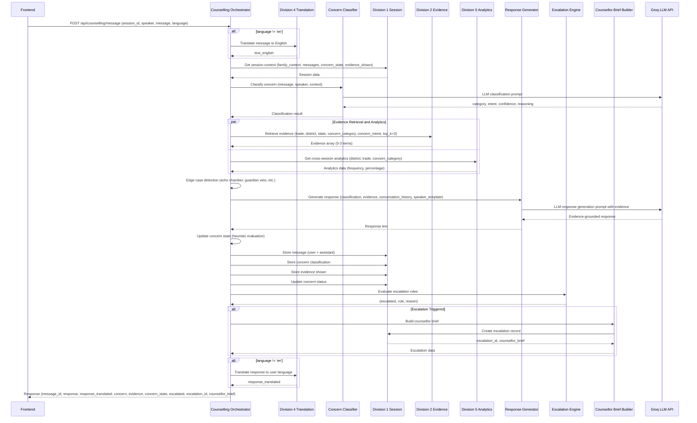

# Design Document: Division 3 - Counselling Orchestrator

## Overview

### Purpose

Division 3 implements the Counselling Orchestrator for the PS 26241 AI-Enabled Career Counselling Platform. This service is the **core intelligence layer** of the platform, responsible for:

1. **Concern Classification**: LLM-based zero-shot classification into 7 categories and 20+ intents
2. **Evidence Orchestration**: Coordinating evidence retrieval from Division 2 with filtering
3. **Response Generation**: Creating evidence-grounded, speaker-aware responses using Groq API
4. **Multi-Turn Management**: Tracking conversation history and concern evolution
5. **Escalation Decision-Making**: Evaluating 5 deterministic rules and generating counsellor briefs
6. **Edge Case Detection**: Identifying echo chambers, guardian vetoes, third-party mentors, reality gaps, gender concerns

The Counselling Orchestrator exposes the main product endpoint `POST /api/counselling/message` which orchestrates the complete counselling flow.

### Key Design Principles

1. **Intelligence-First**: Division 3 owns all decision-making logic (classification, escalation, pattern detection)
2. **Orchestration-Centric**: Coordinates Division 1 (session state), Division 2 (evidence), Division 4 (translation), Division 5 (analytics)
3. **Speaker-Aware**: Three prompt template sets (learner/parent/guardian) for culturally appropriate responses
4. **Evidence-Grounded**: All responses must cite verified MSDE outcome data
5. **Deterministic Escalation**: 5 explicit escalation rules evaluated in precedence order
6. **Graceful Degradation**: Service failures (translation, analytics) don't block core counselling
7. **Async-First**: All I/O operations use async/await for 50+ concurrent sessions
8. **Performance**: 95% of requests complete within 5 seconds (target: <3s average)

### Technology Stack

- **Web Framework**: FastAPI (async endpoints)
- **LLM Provider**: Groq API with llama-3.1-8b-instant (primary), Ollama (fallback)
- **HTTP Client**: httpx (async) for all Division integrations
- **Prompt Management**: Jinja2 templates for speaker-aware prompts
- **Error Handling**: Tenacity for retries with exponential backoff, circuit breakers
- **Logging**: Python logging with structured JSON output
- **Configuration**: pydantic-settings for environment-based configuration

## Architecture

### System Components

Division 3 consists of nine primary components organized into three layers:

#### Layer 1: Core Orchestration

**1. Counselling Orchestration Controller** (`app/services/counselling_orchestrator.py`)
- Main entry point for `POST /api/counselling/message`
- Coordinates all sub-components in the counselling pipeline
- Manages async execution flow and error handling
- Implements circuit breakers for external services
- Tracks performance metrics (timing breakdown per request)

#### Layer 2: Intelligence Components

**2. Concern Classifier** (`app/services/concern_classifier.py`)
- LLM-based zero-shot/few-shot classification
- Accepts: message text, speaker type, session context (trades, district, state)
- Returns: (category, intent, confidence, reasoning)
- Uses Groq API with structured output prompting
- Fallback to Ollama if Groq unavailable
- Classification timeout: 2 seconds

**3. Prompt Manager** (`app/services/prompt_manager.py`)
- Maintains three prompt template sets: learner_prompts, parent_prompts, guardian_prompts
- Selects appropriate template based on speaker type
- Template placeholders: speaker_name, concern_category, concern_intent, trade, district, state, evidence_summary, conversation_history
- Implements prompt caching for performance
- Handles multi-speaker scenarios (selects most conservative template)

**4. Response Generator** (`app/services/response_generator.py`)
- LLM-based evidence-grounded response generation
- Constructs prompts with: system prompt (speaker-aware), conversation history (last 5 turns), current message, concern classification, formatted evidence array
- Uses Groq API with temperature=0.7, max_tokens=300
- Validates response length (50-400 words)
- Truncates at last complete sentence if exceeds 400 words
- Retry logic: 3 attempts with exponential backoff (1s, 2s, 4s)

**5. Escalation Rules Engine** (`app/services/escalation_engine.py`)
- Evaluates 5 deterministic escalation rules in precedence order:
  1. Explicit human counsellor request (keyword detection)
  2. Required evidence unavailable (employment placement_probability or safety concerns)
  3. Safety concern with insufficient evidence (<2 items)
  4. Turn limit exceeded (5+ turns, concern still open/partially_resolved)
  5. Low confidence + user dissatisfaction (confidence <0.5 + frustration keywords)
- Returns: (escalated: bool, trigger_rule: str, reason: str)
- Logs which rule triggered for analytics

**6. Counsellor Brief Builder** (`app/services/counsellor_brief_builder.py`)
- Generates structured counsellor briefs when escalation occurs
- Identifies primary concern (most recent open concern or trigger concern)
- Identifies secondary concern (second most recent unresolved concern)
- Compiles information_already_provided list: ['placement_rate', 'earnings_range', 'nsqf_level', 'career_progression', 'reality_check', 'gender_context']
- Generates escalation_reason (human-readable explanation)
- Generates recommended_action (specific next steps for counsellor)
- Calls Division 1 internal API to create escalation record

#### Layer 3: State Management & Edge Case Detection

**7. Conversation State Manager** (`app/services/conversation_state_manager.py`)
- Retrieves session context from Division 1 (family_context, messages, concern_state, evidence_shown)
- Tracks conversation history (last 5 turns for LLM context)
- Stores user and assistant messages via Division 1
- Tracks evidence shown (deduplication)
- Maintains turn counters per concern intent
- Resets turn counters when concern status → 'resolved'

**8. Concern State Calculator** (`app/services/concern_state_calculator.py`)
- Computes hierarchical concern state (intent-level → category-level)
- Stores detected concerns in Division 1
- Evaluates concern resolution using heuristic rules:
  - Evidence retrieved AND shown
  - Response length > 100 words
  - Evidence matches concern intent
  - Classification confidence >= 0.7
- Updates intent status: 'open' → 'partially_resolved' → 'resolved'
- Computes category status from intent statuses:
  - Any intent 'open' → category 'open'
  - All intents 'resolved' → category 'resolved'
  - Otherwise → category 'partially_resolved'

**9. Edge Case Detector Suite** (`app/services/edge_case_detectors.py`)
- **Echo Chamber Detector**: Calls Division 5 for cross-session analytics (district + trade + concern_category), compares against threshold (default 70%), flags if exceeded, includes context in LLM prompt
- **Guardian Veto Detector**: Analyzes speaker patterns (guardian raises 3+ concerns, learner hasn't objected, concerns primarily social_perception/income/employment), flags pattern, adjusts prompt tone
- **Third-Party Mentor Detector**: Detects mentions of external guidance ("teacher said", "uncle suggested"), flags pattern, generates session summary on request
- **Reality Check Presenter**: Prioritizes evidence with reality_check fields for under-18 learners, includes physical_demand, typical_day, trainee_quote in prompt
- **Gender Context Handler**: Prioritizes evidence with female_enrollment_pct and safety_infrastructure for gender_family concerns, formats inclusively in response

### Data Flow



### Scalability and Performance Considerations

**Current Design (50 concurrent sessions)**:
- Async HTTP clients with connection pooling (max 100 connections per service)
- Parallel API calls where dependencies allow (translation + evidence retrieval)
- Groq API timeout: 10s (covers classification + generation)
- Division API timeouts: D1=3s, D2=5s, D4=3s, D5=2s
- Target latency: 95th percentile < 5s, average < 3s

**Performance Optimizations**:
1. **Prompt Caching**: Cache compiled Jinja2 templates in memory
2. **Evidence Deduplication**: Query evidence_shown history once per request, filter in memory
3. **Conversation History**: Limit to last 5 turns (balance context vs token cost)
4. **Parallel Execution**: Classify → (Retrieve Evidence || Get Analytics) → Generate
5. **Circuit Breakers**: Skip optional services (D5 analytics, D4 translation) if failing

**Future Scaling (> 100 concurrent sessions)**:
- Migrate to Redis for session state caching (reduce D1 query latency)
- Implement response caching for common concerns (trade + district + concern combinations)
- Add Groq API request queuing to avoid rate limits
- Consider streaming responses for real-time user feedback

## Components and Interfaces

### 1. Counselling Orchestration Controller

**Module**: `app/services/counselling_orchestrator.py`

**Responsibility**: Main entry point for counselling message processing

**Key Function**:

```python
async def process_message(
    session_id: str,
    speaker: str,
    message: str,
    language: str
) -> CounsellingResponse:
    """
    Process a counselling message through the complete pipeline.
    
    Pipeline:
    1. Translate message to English (if needed)
    2. Retrieve session context from Division 1
    3. Classify concern using LLM
    4. Retrieve evidence from Division 2 (parallel with analytics)
    5. Get cross-session analytics from Division 5
    6. Detect edge case patterns
    7. Generate speaker-aware response using LLM
    8. Update concern state
    9. Store message, concern, evidence in Division 1
    10. Evaluate escalation rules
    11. Generate counsellor brief (if escalated)
    12. Translate response to user language
    13. Return complete API response
    
    Args:
        session_id: Session identifier
        speaker: Speaker type (learner/parent/guardian)
        message: User message text
        language: User's preferred language code
        
    Returns:
        CounsellingResponse with all required fields
        
    Raises:
        HTTPException(503): LLM service unavailable
        HTTPException(500): Internal server error
        HTTPException(408): Request timeout exceeded
    """
```

**Error Handling Strategy**:
- Groq API failure → Retry 3x with exponential backoff → Fallback to Ollama → Return 503
- Division 2 unavailable → Generate response acknowledging limitation → Offer escalation
- Division 4 unavailable → Proceed with English-only → Log warning → Continue
- Division 5 unavailable → Skip echo chamber detection → Continue
- Division 1 database error → Return 500

**Performance Tracking**:
```python
# Log timing breakdown
metrics = {
    "translation_time_ms": translate_time,
    "classification_time_ms": classify_time,
    "retrieval_time_ms": retrieve_time,
    "generation_time_ms": generate_time,
    "total_time_ms": total_time
}
```

### 2. Concern Classifier

**Module**: `app/services/concern_classifier.py`

**Responsibility**: Classify user messages into concern categories and intents

**Key Functions**:

```python
class ConcernClassifier:
    def __init__(self, groq_client: Groq, ollama_client: Optional[Ollama] = None):
        self.groq = groq_client
        self.ollama = ollama_client
        self.categories = {
            'income': ['starting_salary', 'long_term_earning', 'salary_comparison', 'return_on_training'],
            'employment': ['placement_probability', 'local_jobs', 'employer_availability', 'job_security'],
            'safety': ['workplace_safety', 'gender_safety', 'travel_safety'],
            'social_perception': ['status_of_trade', 'peer_comparison', 'family_acceptance'],
            'education_progression': ['nsqf_levels', 'further_education', 'degree_equivalence'],
            'gender_family': ['suitability_for_daughter', 'family_approval', 'migration_concern'],
            'information_gap': ['course_content', 'duration', 'fees', 'eligibility']
        }
    
    async def classify(
        self,
        message: str,
        speaker: str,
        context: SessionContext
    ) -> ClassificationResult:
        """
        Classify user message into concern category and intent.
        
        Uses zero-shot classification with structured output prompting.
        
        Args:
            message: User message text (English)
            speaker: Speaker type (learner/parent/guardian)
            context: Session context (trades_of_interest, district, state)
            
        Returns:
            ClassificationResult(category, intent, confidence, reasoning)
        """
        prompt = self._build_classification_prompt(message, speaker, context)
        
        try:
            response = await self._call_groq(prompt, timeout=2.0)
            result = self._parse_classification(response)
            return result
        except GroqAPIException as e:
            if self.ollama:
                logger.warning(f"Groq failed, falling back to Ollama: {e}")
                response = await self._call_ollama(prompt, timeout=3.0)
                result = self._parse_classification(response)
                return result
            raise
    
    def _build_classification_prompt(
        self,
        message: str,
        speaker: str,
        context: SessionContext
    ) -> str:
        """
        Build classification prompt with taxonomy and context.
        
        Prompt structure:
        - System: "You are an expert concern classifier for vocational education."
        - Context: trades_of_interest, district, state, speaker
        - Taxonomy: 7 categories with intents
        - Message: user input
        - Output format: category, intent, confidence (0.0-1.0), reasoning
        """
        return f"""You are an expert concern classifier for vocational education counselling in India.

**Context:**
- Trades of Interest: {', '.join(context.trades_of_interest)}
- Location: {context.district}, {context.state}
- Speaker: {speaker}

**User Message:**
"{message}"

**Valid Concern Categories and Intents:**
{self._format_taxonomy()}

**Task:** Classify the user's message into ONE category and ONE intent. Provide confidence (0.0-1.0) and reasoning.

**Output Format (strict JSON):**
{{
  "category": "<category_name>",
  "intent": "<intent_name>",
  "confidence": <0.0-1.0>,
  "reasoning": "<brief explanation>"
}}

Classification:"""
    
    def _parse_classification(self, response: str) -> ClassificationResult:
        """
        Parse LLM classification output.
        
        Handles:
        - Valid JSON output
        - Malformed JSON (extract with regex)
        - Missing fields (use defaults)
        - Invalid category/intent (map to information_gap/course_content)
        """
        try:
            data = json.loads(response)
            category = data.get('category', 'information_gap')
            intent = data.get('intent', 'course_content')
            confidence = float(data.get('confidence', 0.5))
            reasoning = data.get('reasoning', 'Classification uncertain')
            
            # Validate category and intent
            if category not in self.categories:
                category = 'information_gap'
            if intent not in self.categories[category]:
                intent = self.categories[category][0]  # Default to first intent
            
            return ClassificationResult(
                category=category,
                intent=intent,
                confidence=confidence,
                reasoning=reasoning
            )
        except json.JSONDecodeError:
            # Fallback regex parsing
            return self._fallback_parse(response)
```

**Classification Prompt Template** (stored in `app/prompts/concern_classification.py`):

```python
CLASSIFICATION_TAXONOMY = """
**Concern Taxonomy:**

1. income
   - starting_salary: Questions about initial earnings after training
   - long_term_earning: Questions about earnings growth over years
   - salary_comparison: Comparing vocational earnings to degree holders
   - return_on_training: ROI questions (training cost vs earnings)

2. employment
   - placement_probability: Will my child get a job after training?
   - local_jobs: Are jobs available in our district/nearby?
   - employer_availability: Are there employers hiring this trade?
   - job_security: Is the job stable long-term?

3. safety
   - workplace_safety: Physical safety concerns (injury, accidents)
   - gender_safety: Safety concerns for girls/women in male-dominated trades
   - travel_safety: Safety traveling to work sites

4. social_perception
   - status_of_trade: Social status/prestige of vocational work
   - peer_comparison: Comparing to peers pursuing degrees
   - family_acceptance: Extended family/community acceptance

5. education_progression
   - nsqf_levels: Questions about NSQF qualification levels
   - further_education: Can they study further after vocational training?
   - degree_equivalence: Is vocational training equivalent to a degree?

6. gender_family
   - suitability_for_daughter: Is this trade suitable for girls?
   - family_approval: Will family accept this decision for daughter?
   - migration_concern: Concerns about daughter relocating for work

7. information_gap
   - course_content: What will they learn in the training?
   - duration: How long is the training program?
   - fees: Training costs and financial assistance
   - eligibility: Admission requirements and prerequisites
"""
```

### 3. Prompt Manager

**Module**: `app/services/prompt_manager.py`

**Responsibility**: Manage speaker-aware prompt templates

**Key Functions**:

```python
class PromptManager:
    def __init__(self):
        self.env = Environment(loader=FileSystemLoader('app/prompts'))
        self.learner_template = self.env.get_template('learner_prompts.jinja2')
        self.parent_template = self.env.get_template('parent_prompts.jinja2')
        self.guardian_template = self.env.get_template('guardian_prompts.jinja2')
    
    def select_template(self, speaker: str, speakers_present: List[str]) -> Template:
        """
        Select appropriate prompt template based on speaker.
        
        When multiple speakers present, use most conservative:
        guardian > parent > learner
        
        Args:
            speaker: Current speaker type
            speakers_present: All speakers in session
            
        Returns:
            Jinja2 Template object
        """
        if 'guardian' in speakers_present:
            return self.guardian_template
        elif 'parent' in speakers_present:
            return self.parent_template
        else:
            return self.learner_template
    
    def build_system_prompt(
        self,
        speaker: str,
        district: str,
        state: str,
        concern_category: str,
        concern_intent: str
    ) -> str:
        """
        Build speaker-aware system prompt.
        
        Template variables:
        - speaker: learner/parent/guardian
        - district: location
        - state: location
        - concern_category: classified category
        - concern_intent: classified intent
        """
        template = self.select_template(speaker, [speaker])
        return template.render(
            speaker=speaker,
            district=district,
            state=state,
            concern_category=concern_category,
            concern_intent=concern_intent
        )
```

**Speaker-Aware Template Examples**:

**Learner Prompts** (`app/prompts/learner_prompts.jinja2`):
```jinja2
You are a friendly career counsellor speaking with a young learner exploring vocational education options in {{ district }}, {{ state }}.

**Tone:** Empowering, career-focused, encouraging
**Focus:** Future opportunities, skill development, personal growth

The learner has a concern about {{ concern_category }} (specifically: {{ concern_intent }}).

**Response Guidelines:**
1. Use verified MSDE outcome data to show real opportunities
2. Highlight career progression paths and skill-building
3. Frame vocational training as a strategic career choice
4. Be honest about challenges while remaining optimistic
5. Cite specific evidence (placement rates, earnings, trainee experiences)

Example opening: "Let's explore what this trade offers for your future..."
```

**Parent Prompts** (`app/prompts/parent_prompts.jinja2`):
```jinja2
You are a practical career counsellor speaking with a parent evaluating vocational education for their child in {{ district }}, {{ state }}.

**Tone:** Practical, outcome-focused, data-driven
**Focus:** Job placement, earnings, return on investment

The parent has a concern about {{ concern_category }} (specifically: {{ concern_intent }}).

**Response Guidelines:**
1. Lead with verified government data (placement rates, earnings)
2. Address practical concerns directly (jobs, income, safety)
3. Acknowledge parental protection instincts
4. Provide concrete numbers and timeframes
5. Reference local success stories if available

Example opening: "Here's the verified data on job placement and earnings for this trade..."
```

**Guardian Prompts** (`app/prompts/guardian_prompts.jinja2`):
```jinja2
You are a respectful career counsellor speaking with a guardian (uncle, grandfather, etc.) making decisions about vocational education for a family member in {{ district }}, {{ state }}.

**Tone:** Respectful, evidence-first, culturally sensitive
**Focus:** Family security, long-term stability, social acceptance

The guardian has a concern about {{ concern_category }} (specifically: {{ concern_intent }}).

**Response Guidelines:**
1. Begin with verified government data (MSDE sources)
2. Acknowledge family responsibility and decision weight
3. Use formal, respectful language
4. Emphasize safety, stability, social standing
5. Provide comprehensive information for informed decision

Example opening: "The government outcome data shows the following verified results..."
```

### 4. Response Generator

**Module**: `app/services/response_generator.py`

**Responsibility**: Generate evidence-grounded LLM responses

**Key Functions**:

```python
class ResponseGenerator:
    def __init__(self, groq_client: Groq, prompt_manager: PromptManager):
        self.groq = groq_client
        self.prompt_manager = prompt_manager
    
    async def generate_response(
        self,
        classification: ClassificationResult,
        evidence: List[Evidence],
        conversation_history: List[Message],
        speaker: str,
        session_context: SessionContext,
        edge_case_flags: EdgeCaseFlags
    ) -> str:
        """
        Generate evidence-grounded response using LLM.
        
        Args:
            classification: Concern classification result
            evidence: Retrieved evidence array (0-3 items)
            conversation_history: Last 5 turns
            speaker: Current speaker type
            session_context: Family context
            edge_case_flags: Detected edge cases (echo chamber, guardian veto, etc.)
            
        Returns:
            Response text (50-400 words)
        """
        # Build system prompt (speaker-aware)
        system_prompt = self.prompt_manager.build_system_prompt(
            speaker=speaker,
            district=session_context.district,
            state=session_context.state,
            concern_category=classification.category,
            concern_intent=classification.intent
        )
        
        # Add edge case context to system prompt
        if edge_case_flags.echo_chamber_detected:
            system_prompt += f"\n\n**IMPORTANT:** This concern is common in {session_context.district} for {classification.category}. Many families express similar views. Focus on factual outcome data to address misconceptions."
        
        if edge_case_flags.guardian_veto_detected:
            system_prompt += "\n\n**IMPORTANT:** A guardian is expressing unresolved concerns while the learner shows interest. Use respectful, evidence-first framing."
        
        # Format conversation history
        history_text = self._format_conversation_history(conversation_history)
        
        # Format evidence with provenance
        evidence_text = self._format_evidence(evidence, classification.category)
        
        # Build user prompt
        user_prompt = f"""**Conversation History:**
{history_text}

**Classified Concern:**
Category: {classification.category}
Intent: {classification.intent}
Confidence: {classification.confidence}

**Verified MSDE Outcome Data:**
{evidence_text}

**Task:** Generate a response that:
1. Directly addresses the {classification.intent} concern
2. Cites specific evidence from above (placement rates, earnings, sources)
3. Acknowledges the speaker's perspective ({speaker})
4. Provides actionable guidance
5. Is 100-300 words

**Your Response:**"""
        
        # Call LLM
        response = await self._call_groq_with_retry(
            system_prompt=system_prompt,
            user_prompt=user_prompt,
            temperature=0.7,
            max_tokens=300
        )
        
        # Validate and truncate if needed
        response = self._validate_and_truncate(response)
        
        return response
    
    def _format_evidence(self, evidence: List[Evidence], concern_category: str) -> str:
        """
        Format evidence array into structured text with provenance.
        
        Includes:
        - Trade, location, placement rate, earnings
        - Data source and period
        - Reality check fields (if available)
        - Gender context fields (if concern_category == 'gender_family')
        """
        if not evidence:
            return "No verified outcome data available for this specific trade and location combination."
        
        formatted = []
        for idx, ev in enumerate(evidence, 1):
            text = f"""Evidence {idx}:
- Trade: {ev.trade}
- Location: {ev.district}, {ev.state}
- Placement Rate: {ev.placement_rate or 'N/A'}
- Earnings: ₹{ev.earnings_min:,} - ₹{ev.earnings_max:,} {ev.currency}
- Source: {ev.data_source} ({ev.data_period})
- NSQF Level: {ev.nsqf_level or 'N/A'}"""
            
            if ev.progression_path:
                text += f"\n- Career Progression: {' → '.join(ev.progression_path)}"
            
            # Include reality check for under-18 learners or information_gap concerns
            if ev.reality_check:
                text += f"\n- Physical Demand: {ev.reality_check.physical_demand}"
                text += f"\n- Typical Day: {ev.reality_check.typical_day}"
                if ev.reality_check.trainee_quote and ev.reality_check.trainee_quote_source:
                    text += f"\n- Trainee Experience: \"{ev.reality_check.trainee_quote}\" (Source: {ev.reality_check.trainee_quote_source})"
            
            # Include gender context for gender_family concerns
            if concern_category == 'gender_family':
                if ev.female_enrollment_pct:
                    text += f"\n- Female Enrollment: {ev.female_enrollment_pct}"
                if ev.safety_infrastructure:
                    text += f"\n- Safety Infrastructure: {ev.safety_infrastructure}"
            
            formatted.append(text)
        
        return "\n\n".join(formatted)
    
    def _validate_and_truncate(self, response: str) -> str:
        """
        Validate response length and truncate if needed.
        
        Rules:
        - Must be 50-400 words
        - If > 400 words, truncate at last complete sentence within 400 words
        - If < 50 words, log warning (but don't fail)
        """
        word_count = len(response.split())
        
        if word_count < 50:
            logger.warning(f"Response too short: {word_count} words")
        
        if word_count > 400:
            sentences = response.split('. ')
            truncated = []
            current_words = 0
            
            for sentence in sentences:
                sentence_words = len(sentence.split())
                if current_words + sentence_words <= 400:
                    truncated.append(sentence)
                    current_words += sentence_words
                else:
                    break
            
            response = '. '.join(truncated) + '.'
            logger.info(f"Truncated response from {word_count} to {current_words} words")
        
        return response
```

### 5. Escalation Rules Engine

**Module**: `app/services/escalation_engine.py`

**Responsibility**: Evaluate deterministic escalation rules

**Key Functions**:

```python
class EscalationRulesEngine:
    def __init__(self, config: EscalationConfig):
        self.config = config  # CONFIDENCE_THRESHOLD, TURN_LIMIT
        self.explicit_request_keywords = [
            'talk to counsellor', 'human counsellor', 'speak to someone',
            'real person', 'escalate', 'counsellor help'
        ]
        self.frustration_keywords = [
            'not helpful', "don't understand", "this isn't working",
            'frustrated', 'confused', 'not clear'
        ]
    
    async def evaluate_escalation(
        self,
        classification: ClassificationResult,
        evidence: List[Evidence],
        concern_history: List[Concern],
        message_text: str,
        session_context: SessionContext
    ) -> EscalationDecision:
        """
        Evaluate 5 escalation rules in precedence order.
        
        Returns EscalationDecision(
            escalated: bool,
            trigger_rule: str,
            reason: str,
            primary_concern: Concern,
            secondary_concern: Optional[Concern]
        )
        """
        # Rule 1: Explicit human counsellor request
        if self._check_explicit_request(message_text):
            return EscalationDecision(
                escalated=True,
                trigger_rule="Rule 1: Explicit Request",
                reason="explicit_human_counsellor_request",
                primary_concern=self._get_primary_concern(concern_history),
                secondary_concern=self._get_secondary_concern(concern_history)
            )
        
        # Rule 2: Required evidence unavailable
        if self._check_required_evidence_unavailable(classification, evidence):
            return EscalationDecision(
                escalated=True,
                trigger_rule="Rule 2: Evidence Unavailable",
                reason="required_evidence_unavailable",
                primary_concern=self._get_primary_concern(concern_history),
                secondary_concern=self._get_secondary_concern(concern_history)
            )
        
        # Rule 3: Safety concern + insufficient evidence
        if self._check_safety_insufficient_evidence(classification, evidence):
            return EscalationDecision(
                escalated=True,
                trigger_rule="Rule 3: Safety + Insufficient Evidence",
                reason="safety_concern_insufficient_evidence",
                primary_concern=self._get_primary_concern(concern_history),
                secondary_concern=self._get_secondary_concern(concern_history)
            )
        
        # Rule 4: Turn limit exceeded
        if self._check_turn_limit_exceeded(concern_history):
            return EscalationDecision(
                escalated=True,
                trigger_rule="Rule 4: Turn Limit Exceeded",
                reason="concern_unresolved_after_turn_limit",
                primary_concern=self._get_primary_concern(concern_history),
                secondary_concern=self._get_secondary_concern(concern_history)
            )
        
        # Rule 5: Low confidence + user dissatisfaction
        if self._check_low_confidence_dissatisfaction(classification, message_text):
            return EscalationDecision(
                escalated=True,
                trigger_rule="Rule 5: Low Confidence + Dissatisfaction",
                reason="low_confidence_with_user_dissatisfaction",
                primary_concern=self._get_primary_concern(concern_history),
                secondary_concern=self._get_secondary_concern(concern_history)
            )
        
        # No escalation
        return EscalationDecision(
            escalated=False,
            trigger_rule=None,
            reason=None,
            primary_concern=None,
            secondary_concern=None
        )
    
    def _check_explicit_request(self, message_text: str) -> bool:
        """Check for explicit counsellor request keywords."""
        message_lower = message_text.lower()
        return any(keyword in message_lower for keyword in self.explicit_request_keywords)
    
    def _check_required_evidence_unavailable(
        self,
        classification: ClassificationResult,
        evidence: List[Evidence]
    ) -> bool:
        """
        Check if evidence is unavailable for critical concerns.
        
        Critical concerns:
        - employment + placement_probability
        - safety (any intent)
        """
        if len(evidence) == 0:
            if classification.category == 'employment' and classification.intent == 'placement_probability':
                return True
            if classification.category == 'safety':
                return True
        return False
    
    def _check_safety_insufficient_evidence(
        self,
        classification: ClassificationResult,
        evidence: List[Evidence]
    ) -> bool:
        """Safety concerns require at least 2 evidence items."""
        return classification.category == 'safety' and len(evidence) < 2
    
    def _check_turn_limit_exceeded(self, concern_history: List[Concern]) -> bool:
        """
        Check if any concern has exceeded turn limit.
        
        Turn limit: concern detected in 5+ messages, status still open/partially_resolved
        """
        concern_counts = {}
        for concern in concern_history:
            key = (concern.category, concern.intent)
            if concern.status in ['open', 'partially_resolved']:
                concern_counts[key] = concern_counts.get(key, 0) + 1
        
        return any(count >= self.config.TURN_LIMIT for count in concern_counts.values())
    
    def _check_low_confidence_dissatisfaction(
        self,
        classification: ClassificationResult,
        message_text: str
    ) -> bool:
        """Low confidence (<0.5) + frustration keywords."""
        if classification.confidence < 0.5:
            message_lower = message_text.lower()
            return any(keyword in message_lower for keyword in self.frustration_keywords)
        return False
```

### 6. Counsellor Brief Builder

**Module**: `app/services/counsellor_brief_builder.py`

**Responsibility**: Generate structured counsellor briefs

**Key Functions**:

```python
class CounsellorBriefBuilder:
    async def build_brief(
        self,
        escalation_decision: EscalationDecision,
        session_context: SessionContext,
        evidence_shown: List[Evidence],
        concern_state: ConcernState
    ) -> CounsellorBrief:
        """
        Build counsellor brief with complete case context.
        
        Returns:
            CounsellorBrief with:
            - learner_education, district, state, trade_interest
            - primary_concern_category, primary_concern_intent
            - secondary_concern_category, secondary_concern_intent (optional)
            - data_already_shown (list of evidence types)
            - concern_status (open/partially_resolved)
            - escalation_reason (human-readable)
            - recommended_action (specific next steps)
        """
        # Identify primary concern (most recent open or trigger concern)
        primary = escalation_decision.primary_concern
        
        # Identify secondary concern (second most recent unresolved)
        secondary = escalation_decision.secondary_concern
        
        # Compile information already provided
        data_shown = self._compile_data_shown(evidence_shown)
        
        # Generate escalation reason
        escalation_reason = self._generate_escalation_reason(escalation_decision)
        
        # Generate recommended action
        recommended_action = self._generate_recommended_action(
            escalation_decision,
            session_context,
            data_shown
        )
        
        brief = CounsellorBrief(
            learner_education=session_context.learner_education,
            district=session_context.district,
            state=session_context.state,
            trade_interest=session_context.trades_of_interest,
            primary_concern_category=primary.category,
            primary_concern_intent=primary.intent,
            secondary_concern_category=secondary.category if secondary else None,
            secondary_concern_intent=secondary.intent if secondary else None,
            data_already_shown=data_shown,
            concern_status=primary.status,
            escalation_reason=escalation_reason,
            recommended_action=recommended_action
        )
        
        return brief
    
    def _compile_data_shown(self, evidence_shown: List[Evidence]) -> List[str]:
        """
        Compile list of evidence types already shown.
        
        Types: placement_rate, earnings_range, nsqf_level,
               career_progression, reality_check, gender_context
        """
        types_shown = set()
        
        for ev in evidence_shown:
            if ev.placement_rate:
                types_shown.add('placement_rate')
            if ev.earnings_min and ev.earnings_max:
                types_shown.add('earnings_range')
            if ev.nsqf_level:
                types_shown.add('nsqf_level')
            if ev.progression_path:
                types_shown.add('career_progression')
            if ev.reality_check:
                types_shown.add('reality_check')
            if ev.female_enrollment_pct or ev.safety_infrastructure:
                types_shown.add('gender_context')
        
        return sorted(list(types_shown))
    
    def _generate_recommended_action(
        self,
        escalation_decision: EscalationDecision,
        session_context: SessionContext,
        data_shown: List[str]
    ) -> str:
        """
        Generate specific recommended action for counsellor.
        
        Tailored to:
        - Trigger rule
        - Primary concern category
        - Location (district, state)
        - Data already shown
        """
        primary = escalation_decision.primary_concern
        
        if escalation_decision.trigger_rule == "Rule 2: Evidence Unavailable":
            return f"Research local {', '.join(session_context.trades_of_interest)} employers in {session_context.district} district. Arrange site visit or employer interaction if possible."
        
        elif escalation_decision.trigger_rule == "Rule 3: Safety + Insufficient Evidence":
            return f"Discuss workplace safety measures for {', '.join(session_context.trades_of_interest)} with the family. Arrange training center visit to see safety infrastructure firsthand."
        
        elif primary.category == 'social_perception':
            return f"Address social perception concerns for {', '.join(session_context.trades_of_interest)} in {session_context.district}. Share local success stories and connect family with current trainees or graduates if possible."
        
        elif primary.category == 'gender_family':
            return f"Discuss gender-specific concerns for {', '.join(session_context.trades_of_interest)}. Highlight female enrollment data, safety measures, and connect family with female trainees/graduates."
        
        else:
            return f"Have a detailed conversation about {primary.category} concerns related to {', '.join(session_context.trades_of_interest)} in {session_context.district}. The AI has already provided: {', '.join(data_shown)}."
```

### 7. Edge Case Detectors

**Module**: `app/services/edge_case_detectors.py`

**Responsibility**: Detect five critical edge-case patterns

**Key Functions**:

```python
class EdgeCaseDetectors:
    def __init__(
        self,
        division5_client: Division5Client,
        config: EdgeCaseConfig
    ):
        self.d5_client = division5_client
        self.config = config  # ECHO_CHAMBER_THRESHOLD, etc.
    
    async def detect_all(
        self,
        classification: ClassificationResult,
        session_context: SessionContext,
        conversation_history: List[Message],
        concern_history: List[Concern]
    ) -> EdgeCaseFlags:
        """
        Detect all edge case patterns in parallel.
        
        Returns EdgeCaseFlags with boolean flags and context.
        """
        results = await asyncio.gather(
            self.detect_echo_chamber(classification, session_context),
            self.detect_guardian_veto(conversation_history, concern_history, session_context),
            self.detect_third_party_mentor(conversation_history),
            self.detect_reality_check_needed(session_context),
            self.detect_gender_context_needed(classification)
        )
        
        return EdgeCaseFlags(
            echo_chamber_detected=results[0],
            guardian_veto_detected=results[1],
            third_party_mentor_detected=results[2],
            reality_check_needed=results[3],
            gender_context_needed=results[4]
        )
    
    async def detect_echo_chamber(
        self,
        classification: ClassificationResult,
        session_context: SessionContext
    ) -> bool:
        """
        Detect echo chamber pattern using Division 5 analytics.
        
        Steps:
        1. Call Division 5 for cross-session analytics (district, trade, concern_category)
        2. Compare concern frequency against threshold (default 70%)
        3. Return True if threshold exceeded
        """
        try:
            analytics = await self.d5_client.get_cross_session_analytics(
                district=session_context.district,
                trade=session_context.trades_of_interest[0],  # Primary trade
                concern_category=classification.category
            )
            
            if analytics and analytics.dominant_percentage >= self.config.ECHO_CHAMBER_THRESHOLD:
                logger.info(
                    f"Echo chamber detected: {classification.category} in "
                    f"{session_context.district} ({analytics.dominant_percentage}%)"
                )
                return True
        except Exception as e:
            logger.warning(f"Division 5 analytics unavailable, skipping echo chamber detection: {e}")
        
        return False
    
    async def detect_guardian_veto(
        self,
        conversation_history: List[Message],
        concern_history: List[Concern],
        session_context: SessionContext
    ) -> bool:
        """
        Detect guardian veto pattern from speaker analysis.
        
        Pattern:
        - Guardian raises 3+ concerns across categories
        - Learner hasn't raised objections
        - Concerns primarily social_perception, income, employment
        """
        if 'guardian' not in session_context.speakers_present:
            return False
        if 'learner' not in session_context.speakers_present:
            return False
        
        # Count concerns by speaker
        guardian_concerns = [c for c in concern_history if self._is_guardian_message(c.message_id, conversation_history)]
        learner_concerns = [c for c in concern_history if self._is_learner_message(c.message_id, conversation_history)]
        
        if len(guardian_concerns) >= 3 and len(learner_concerns) == 0:
            # Check concern types
            veto_categories = ['social_perception', 'income', 'employment']
            guardian_veto_concerns = [c for c in guardian_concerns if c.category in veto_categories]
            
            if len(guardian_veto_concerns) >= 2:
                logger.info(f"Guardian veto pattern detected in session {session_context.session_id}")
                return True
        
        return False
    
    async def detect_third_party_mentor(
        self,
        conversation_history: List[Message]
    ) -> bool:
        """
        Detect third-party mentor involvement.
        
        Keywords: "teacher said", "uncle suggested", "counsellor recommended", "someone told me"
        """
        mentor_keywords = [
            'teacher said', 'uncle suggested', 'counsellor recommended',
            'someone told me', 'mentor advised', 'relative said'
        ]
        
        mention_count = 0
        for message in conversation_history:
            if message.message_type == 'user':
                message_lower = message.text_original.lower()
                if any(keyword in message_lower for keyword in mentor_keywords):
                    mention_count += 1
        
        return mention_count >= 2
    
    async def detect_reality_check_needed(
        self,
        session_context: SessionContext
    ) -> bool:
        """
        Detect if reality check needed (under-18 learner).
        
        Education levels indicating under-18:
        - "Class 10", "Class 12", "10th pass", "12th pass"
        """
        education_lower = session_context.learner_education.lower()
        under_18_indicators = ['class 10', 'class 12', '10th', '12th', 'secondary']
        
        return any(indicator in education_lower for indicator in under_18_indicators)
    
    async def detect_gender_context_needed(
        self,
        classification: ClassificationResult
    ) -> bool:
        """
        Detect if gender context needed.
        
        Trigger: concern_category == 'gender_family'
        """
        return classification.category == 'gender_family'
```

## Correctness Properties

*A property is a characteristic or behavior that should hold true across all valid executions of a system—essentially, a formal statement about what the system should do. Properties serve as the bridge between human-readable specifications and machine-verifiable correctness guarantees.*

### Property-Based Testing Applicability Assessment

Division 3 implements orchestration logic, LLM integration, and rule-based decision-making. Property-based testing IS appropriate for:
- Internal logic (concern state calculation, escalation rules evaluation, speaker template selection)
- Parser robustness (LLM output parsing with malformed inputs)
- Deterministic algorithms (hierarchical concern state, evidence deduplication)

Property-based testing is NOT appropriate for:
- External API calls (Groq, Division 1-5) → Use integration tests with mocks
- Database operations → Use integration tests
- End-to-end counselling flow → Use scenario-based integration tests

Therefore, the Correctness Properties section will focus on testable internal logic.


### Property Reflection

After reviewing all 19 requirements with 100+ acceptance criteria, I identified testable properties for Division 3's internal logic:

**Parser Logic (Concern Classification Output)**:
- Properties 1, 2, 3: All test classification output validation (category, intent, confidence) → **Combine into single comprehensive parsing property**

**Prompt Selection (Speaker-Aware Templates)**:
- Properties 4, 5, 6: All test speaker → template mapping → **Combine into single property**
- Property 7: Multi-speaker precedence is distinct → **Keep separate**

**Response Validation (Length and Truncation)**:
- Properties 8, 9: Response validation and truncation are complementary → **Keep both** (different algorithms)

**Escalation Rules (Evaluation Logic)**:
- Properties 10-15: Each rule tests different conditions → **Keep separate** (5 distinct rules)
- Property 16: Rule precedence is overarching → **Keep separate**

**Concern State Calculation (Hierarchical Logic)**:
- Property 17: Intent → Category status computation is core algorithm → **Keep separate**
- Property 18: Concern resolution heuristic is distinct → **Keep separate**

**Edge Case Detection**:
- Properties 19-23: Each detector has unique logic → **Keep separate**

**Final Property Count**: 18 properties covering internal orchestration logic

### Property 1: Classification Parser Robustness

*For any* LLM classification output string (valid JSON, malformed JSON, missing fields, extra fields), the classification parser SHALL either return a valid ClassificationResult with category in {income, employment, safety, social_perception, education_progression, gender_family, information_gap}, intent matching the category's intent list, and confidence clamped to [0.0, 1.0], OR raise a ParseException without crashing.

**Validates: Requirements 1.3, 1.4, 1.5**

### Property 2: Confidence Threshold Flagging

*For any* classification result with confidence score c, if c < 0.7 then the low_confidence flag SHALL be set to True, otherwise False.

**Validates: Requirements 1.6**

### Property 3: Speaker Template Selection Determinism

*For any* speaker type in {learner, parent, guardian}, the prompt template selection SHALL be deterministic: learner → learner_template, parent → parent_template, guardian → guardian_template.

**Validates: Requirements 2.2, 2.3, 2.4**

### Property 4: Multi-Speaker Prompt Precedence

*For any* set of speakers_present containing multiple speaker types, the selected prompt template SHALL follow precedence order: if 'guardian' in speakers_present then guardian_template, else if 'parent' in speakers_present then parent_template, else learner_template.

**Validates: Requirements 2.7**

### Property 5: Response Length Validation

*For any* response text, the word count SHALL be computed as len(response.split()), and if word_count > 400, a warning SHALL be logged (property: logging occurs).

**Validates: Requirements 4.8**

### Property 6: Response Truncation Preserves Sentences

*For any* response text with word_count > 400, truncating at the last complete sentence within 400 words SHALL produce a new response where: (1) word_count <= 400, (2) the response ends with '.', (3) no partial sentences exist at the end.

**Validates: Requirements 4.9**

### Property 7: Evidence Deduplication

*For any* evidence_shown history (list of evidence_ids) and new_evidence array (list of Evidence objects), filtering new_evidence to exclude evidence_ids already in evidence_shown SHALL produce a result array where no evidence_id appears in evidence_shown.

**Validates: Requirements 5.6**

### Property 8: Concern Repetition Detection

*For any* concern_history (list of Concern objects), if the same (category, intent) pair appears in concerns with status 'open' or 'partially_resolved' at least 3 times, the repetition_detected flag SHALL be True.

**Validates: Requirements 5.7**

### Property 9: Turn Counter Per Intent

*For any* concern_history grouped by (category, intent) pairs, the turn counter for each intent SHALL equal the number of times that intent was detected with status != 'resolved'.

**Validates: Requirements 5.8**

### Property 10: Concern Resolution Heuristic

*For any* concern resolution evaluation with inputs: evidence_retrieved (bool), evidence_shown (bool), response_length (int), intent_match (bool), confidence (float >= 0.7), the resolution status SHALL be 'resolved' if ALL conditions are True, 'partially_resolved' if SOME conditions are True, else remain 'open'.

**Validates: Requirements 6.3**

### Property 11: Hierarchical Concern State Calculation

*For any* category with intent_statuses dict (mapping intent names to statuses), the category_status SHALL be: 'open' if any intent is 'open', 'resolved' if ALL intents are 'resolved', 'partially_resolved' otherwise. If no intents exist, category_status SHALL be 'not_raised'.

**Validates: Requirements 6.7**

### Property 12: Escalation Rule Precedence

*For any* escalation evaluation, if multiple rules trigger, the FIRST triggered rule in precedence order (Rule 1 → Rule 2 → Rule 3 → Rule 4 → Rule 5) SHALL be the escalation trigger, and subsequent rules SHALL NOT be evaluated.

**Validates: Requirements 7.1**

### Property 13: Escalation Rule 1 - Explicit Request Detection

*For any* message_text containing any substring in {\"talk to counsellor\", \"human counsellor\", \"speak to someone\", \"real person\"} (case-insensitive), Rule 1 SHALL trigger with reason \"explicit_human_counsellor_request\".

**Validates: Requirements 7.2**

### Property 14: Escalation Rule 2 - Required Evidence Unavailable

*For any* classification with (category='employment' AND intent='placement_probability') OR (category='safety') AND evidence array length == 0, Rule 2 SHALL trigger with reason \"required_evidence_unavailable\".

**Validates: Requirements 7.3**

### Property 15: Escalation Rule 3 - Safety Insufficient Evidence

*For any* classification with category='safety' AND evidence array length < 2, Rule 3 SHALL trigger with reason \"safety_concern_insufficient_evidence\".

**Validates: Requirements 7.4**

### Property 16: Escalation Rule 4 - Turn Limit Exceeded

*For any* concern_history where a (category, intent) pair appears with status 'open' or 'partially_resolved' in >= 5 messages, Rule 4 SHALL trigger with reason \"concern_unresolved_after_turn_limit\".

**Validates: Requirements 7.5**

### Property 17: Escalation Rule 5 - Low Confidence + Dissatisfaction

*For any* classification with confidence < 0.5 AND message_text containing any frustration keyword {\"not helpful\", \"don't understand\", \"this isn't working\"} (case-insensitive), Rule 5 SHALL trigger with reason \"low_confidence_with_user_dissatisfaction\".

**Validates: Requirements 7.6**

### Property 18: Information Already Provided Compilation

*For any* evidence_shown array, compiling information_already_provided SHALL produce a list containing unique evidence types: 'placement_rate' if any evidence.placement_rate != None, 'earnings_range' if any evidence has both earnings_min and earnings_max, 'nsqf_level' if any evidence.nsqf_level != None, 'career_progression' if any evidence.progression_path != None, 'reality_check' if any evidence.reality_check != None, 'gender_context' if any evidence has female_enrollment_pct or safety_infrastructure.

**Validates: Requirements 8.4**

### Property 19: Echo Chamber Threshold Detection

*For any* analytics data with dominant_percentage value p and configured ECHO_CHAMBER_THRESHOLD t (default 70.0), the echo_chamber_detected flag SHALL be True if p >= t, else False.

**Validates: Requirements 9.4**

### Property 20: Guardian Veto Pattern Detection

*For any* conversation_history with speaker annotations and concern_history with message_id references, the guardian_veto_detected flag SHALL be True if: (1) guardian raised >= 3 concerns, (2) learner raised 0 concerns, (3) >= 2 guardian concerns are in {social_perception, income, employment}.

**Validates: Requirements 10.3**

### Property 21: Third-Party Mentor Keyword Detection

*For any* conversation_history (list of user messages), if >= 2 messages contain any mentor keyword {\"teacher said\", \"uncle suggested\", \"counsellor recommended\", \"someone told me\"} (case-insensitive), the third_party_mentor_detected flag SHALL be True.

**Validates: Requirements 11.2**

## Data Models

### Request and Response Schemas

**Request Schema**: `POST /api/counselling/message`

```python
class CounsellingMessageRequest(BaseModel):
    """Request schema for counselling message."""
    session_id: str = Field(..., min_length=1, max_length=50)
    speaker: str = Field(..., pattern="^(learner|parent|guardian)$")
    message: str = Field(..., min_length=1, max_length=2000)
    language: str = Field(..., min_length=2, max_length=10)
```

**Response Schema**:

```python
class ConcernResponse(BaseModel):
    """Concern classification result."""
    category: str = Field(..., description="Concern category")
    intent: str = Field(..., description="Concern intent")
    confidence: float = Field(..., ge=0.0, le=1.0, description="Classification confidence")
    raw_text: str = Field(..., description="Original user message")


class CounsellorBriefResponse(BaseModel):
    """Counsellor brief for escalated cases."""
    learner_education: str
    district: str
    state: str
    trade_interest: List[str]
    primary_concern_category: str
    primary_concern_intent: str
    secondary_concern_category: Optional[str] = None
    secondary_concern_intent: Optional[str] = None
    data_already_shown: List[str]
    concern_status: str
    escalation_reason: str
    recommended_action: str


class CounsellingMessageResponse(BaseModel):
    """Response schema for counselling message."""
    message_id: str = Field(..., description="Generated message ID")
    response: str = Field(..., description="Response in English")
    response_translated: Optional[str] = Field(None, description="Response in user's language")
    concern: ConcernResponse = Field(..., description="Classified concern")
    evidence: List[Evidence] = Field(default_factory=list, description="Evidence shown (0-3 items)")
    concern_state: ConcernState = Field(..., description="Updated concern state")
    escalated: bool = Field(False, description="Whether escalation occurred")
    escalation_id: Optional[str] = Field(None, description="Escalation ID if escalated")
    counsellor_brief: Optional[CounsellorBriefResponse] = Field(None, description="Counsellor brief if escalated")
```

### Internal Data Models

**Classification Result**:

```python
class ClassificationResult(BaseModel):
    """Internal concern classification result."""
    category: str
    intent: str
    confidence: float = Field(ge=0.0, le=1.0)
    reasoning: str
    low_confidence: bool = False  # Set True if confidence < 0.7


class SessionContext(BaseModel):
    """Session context for classification and response generation."""
    session_id: str
    district: str
    state: str
    learner_education: str
    income_bracket: str
    trades_of_interest: List[str]
    speakers_present: List[str]
    preferred_language: str
```

**Escalation Decision**:

```python
class EscalationDecision(BaseModel):
    """Result of escalation rules evaluation."""
    escalated: bool
    trigger_rule: Optional[str] = None  # e.g., "Rule 1: Explicit Request"
    reason: Optional[str] = None  # e.g., "explicit_human_counsellor_request"
    primary_concern: Optional[Concern] = None
    secondary_concern: Optional[Concern] = None


class EdgeCaseFlags(BaseModel):
    """Flags for detected edge-case patterns."""
    echo_chamber_detected: bool = False
    guardian_veto_detected: bool = False
    third_party_mentor_detected: bool = False
    reality_check_needed: bool = False
    gender_context_needed: bool = False
```

### Division Integration Schemas

**Division 1 Internal APIs**:

```python
# POST /api/internal/session/{session_id}/messages
class MessageCreateRequest(BaseModel):
    messages: List[InternalMessageItem]


# POST /api/internal/session/{session_id}/concerns
class ConcernCreateRequest(BaseModel):
    message_id: str
    category: str
    intent: str
    confidence: float
    raw_text: str


# POST /api/internal/session/{session_id}/evidence
class EvidenceCreateRequest(BaseModel):
    evidence_id: str
    message_id: str
    trade: str
    district: str
    state: str
    placement_rate: Optional[str]
    earnings_min: Optional[int]
    earnings_max: Optional[int]
    # ... other evidence fields


# POST /api/internal/session/{session_id}/escalations
class EscalationCreateRequest(BaseModel):
    trigger_reason: str
    primary_concern_category: str
    primary_concern_intent: str
    secondary_concern_category: Optional[str]
    secondary_concern_intent: Optional[str]
    information_already_provided: List[str]
    concern_status: str
    escalation_reason: str
    recommended_action: str
```

**Division 2 Internal API**:

```python
# POST /api/internal/evidence/retrieve
class EvidenceRetrieveRequest(BaseModel):
    trade: Optional[str] = None
    district: Optional[str] = None
    state: Optional[str] = None
    concern_category: Optional[str] = None
    concern_intent: Optional[str] = None
    query_text: Optional[str] = None
    top_k: int = Field(default=3, ge=1, le=10)


class EvidenceRetrieveResponse(BaseModel):
    evidence: List[Evidence]
```

**Division 4 Internal API**:

```python
# POST /api/internal/language/translate
class TranslateRequest(BaseModel):
    text: str
    source_lang: str
    target_lang: str


class TranslateResponse(BaseModel):
    translated_text: str
    detected_lang: str
```

**Division 5 Internal API**:

```python
# GET /api/internal/analytics/cross-session?district={}&trade={}&concern_category={}
class CrossSessionAnalytics(BaseModel):
    district: str
    trade: str
    total_sessions: int
    concern_category: str
    concern_frequency: int
    dominant_percentage: float  # 0.0-100.0
```

### Configuration Models

```python
class GroqConfig(BaseModel):
    """Groq API configuration."""
    api_key: str
    model_name: str = "llama-3.1-8b-instant"
    temperature: float = 0.7
    max_tokens: int = 300
    timeout: int = 10  # seconds


class EscalationConfig(BaseModel):
    """Escalation rules configuration."""
    confidence_threshold: float = 0.7
    turn_limit: int = 5
    echo_chamber_threshold: float = 70.0  # percentage


class DivisionEndpoints(BaseModel):
    """External division API endpoints."""
    division1_base_url: str
    division2_base_url: str
    division4_base_url: str
    division5_base_url: str
```

## Error Handling

### Error Handling Strategy

Division 3 implements a layered error handling approach:

#### Layer 1: External API Failures

**Groq LLM API**:
```python
async def _call_groq_with_retry(prompt: str) -> str:
    """Call Groq with exponential backoff retry."""
    for attempt in range(3):
        try:
            response = await groq_client.chat.completions.create(...)
            return response.choices[0].message.content
        except GroqAPIException as e:
            if attempt < 2:
                await asyncio.sleep(2 ** attempt)  # 1s, 2s, 4s
                continue
            # Final attempt failed
            if ollama_client:
                logger.warning("Groq failed, falling back to Ollama")
                return await _call_ollama(prompt)
            raise HTTPException(503, "LLM service unavailable")
```

**Division 2 Evidence Retrieval**:
```python
try:
    evidence = await division2_client.retrieve_evidence(...)
except Division2Exception as e:
    logger.error(f"Division 2 unavailable: {e}")
    # Generate response acknowledging limitation
    response = f"I'm currently unable to retrieve specific outcome data for {trade} in {district}. Would you like me to escalate this to a human counsellor who can help?"
    # Continue with empty evidence array, trigger escalation
```

**Division 4 Translation** (graceful degradation):
```python
try:
    translated = await division4_client.translate(text, source, target)
except Division4Exception as e:
    logger.warning(f"Translation unavailable: {e}")
    # Proceed with English-only
    translated = None
    # Continue processing
```

**Division 5 Analytics** (optional service):
```python
try:
    analytics = await division5_client.get_cross_session_analytics(...)
except Division5Exception as e:
    logger.warning(f"Analytics unavailable, skipping echo chamber detection: {e}")
    # Skip edge case detection
    echo_chamber_detected = False
```

#### Layer 2: Circuit Breakers

```python
class CircuitBreaker:
    """Implement circuit breaker pattern for external services."""
    def __init__(self, failure_threshold: int = 5, timeout: int = 60):
        self.failure_count = 0
        self.failure_threshold = failure_threshold
        self.timeout = timeout
        self.last_failure_time = None
        self.state = "closed"  # closed, open, half_open
    
    async def call(self, func, *args, **kwargs):
        if self.state == "open":
            if time.time() - self.last_failure_time >= self.timeout:
                self.state = "half_open"
            else:
                raise CircuitBreakerOpenException("Circuit breaker open")
        
        try:
            result = await func(*args, **kwargs)
            self.failure_count = 0
            self.state = "closed"
            return result
        except Exception as e:
            self.failure_count += 1
            self.last_failure_time = time.time()
            if self.failure_count >= self.failure_threshold:
                self.state = "open"
                logger.error(f"Circuit breaker opened for {func.__name__}")
            raise
```

#### Layer 3: Request Timeout

```python
async def process_message(session_id, speaker, message, language):
    """Main orchestration with 15-second timeout."""
    try:
        async with asyncio.timeout(15):  # Overall timeout
            # Pipeline execution
            ...
    except asyncio.TimeoutError:
        logger.error(f"Request timeout for session {session_id}")
        raise HTTPException(408, "Request timeout exceeded")
```

### Error Response Schema

```python
class ErrorResponse(BaseModel):
    """Standard error response."""
    error: str = Field(..., description="Error type")
    message: str = Field(..., description="Human-readable error message")
    detail: Optional[str] = Field(None, description="Additional error details")
    request_id: Optional[str] = Field(None, description="Request ID for debugging")


# Example error responses
# 503: LLM Service Unavailable
{
    "error": "service_unavailable",
    "message": "LLM service unavailable. Please try again in a few minutes.",
    "detail": "Groq API timeout after 3 retries",
    "request_id": "req_abc123"
}

# 408: Request Timeout
{
    "error": "timeout",
    "message": "Request timeout exceeded",
    "detail": "Processing took longer than 15 seconds",
    "request_id": "req_def456"
}

# 500: Internal Server Error
{
    "error": "internal_error",
    "message": "Internal server error. Please contact support.",
    "detail": "Division 1 database connection failed",
    "request_id": "req_ghi789"
}
```

## Testing Strategy

### Testing Approach Overview

Division 3 requires a three-tier testing strategy:

1. **Property-Based Tests**: Internal logic (concern classification parser, escalation rules, hierarchical concern state)
2. **Integration Tests**: External API interactions (Division 1-5, Groq API) with mocks
3. **End-to-End Tests**: Complete counselling flows for 5 edge-case scenarios

### Property-Based Tests

**Testing Framework**: Hypothesis (Python)

**Property Test 1**: Classification Parser Robustness

```python
from hypothesis import given, strategies as st
import json

@given(
    category=st.sampled_from(['income', 'employment', 'safety', 'social_perception', 
                               'education_progression', 'gender_family', 'information_gap', 'INVALID']),
    intent=st.text(min_size=1, max_size=50),
    confidence=st.floats(min_value=-1.0, max_value=2.0),  # Include invalid range
    extra_fields=st.dictionaries(st.text(), st.text())
)
def test_classification_parser_robustness(category, intent, confidence, extra_fields):
    """Property: Parser handles any LLM output without crashing."""
    # Generate various malformed outputs
    test_cases = [
        # Valid JSON
        json.dumps({"category": category, "intent": intent, "confidence": confidence}),
        # Malformed JSON
        f"category: {category}, intent: {intent}, confidence: {confidence}",
        # Missing fields
        json.dumps({"category": category}),
        # Extra fields
        json.dumps({"category": category, "intent": intent, "confidence": confidence, **extra_fields}),
        # Empty string
        "",
        # Very long string
        "x" * 10000
    ]
    
    for output in test_cases:
        try:
            result = concern_classifier._parse_classification(output)
            # Valid result: category must be one of 7 valid, confidence in [0, 1]
            assert result.category in ['income', 'employment', 'safety', 'social_perception',
                                        'education_progression', 'gender_family', 'information_gap']
            assert 0.0 <= result.confidence <= 1.0
        except ParseException:
            # Acceptable to raise exception, but shouldn't crash
            pass
```

**Property Test 2**: Hierarchical Concern State Calculation

```python
@given(
    intent_statuses=st.dictionaries(
        keys=st.text(min_size=1, max_size=30),
        values=st.sampled_from(['open', 'partially_resolved', 'resolved']),
        min_size=0,
        max_size=10
    )
)
def test_hierarchical_concern_state(intent_statuses):
    """Property: Category status derived correctly from intent statuses."""
    category_status = concern_state_calculator.compute_category_status(intent_statuses)
    
    if len(intent_statuses) == 0:
        assert category_status == 'not_raised'
    elif any(status == 'open' for status in intent_statuses.values()):
        assert category_status == 'open'
    elif all(status == 'resolved' for status in intent_statuses.values()):
        assert category_status == 'resolved'
    else:
        assert category_status == 'partially_resolved'
```

**Property Test 3**: Escalation Rule Precedence

```python
@given(
    explicit_request=st.booleans(),
    evidence_count=st.integers(min_value=0, max_value=5),
    safety_concern=st.booleans(),
    turn_count=st.integers(min_value=0, max_value=10),
    confidence=st.floats(min_value=0.0, max_value=1.0),
    frustration=st.booleans()
)
def test_escalation_rule_precedence(explicit_request, evidence_count, safety_concern, turn_count, confidence, frustration):
    """Property: First triggered rule takes precedence."""
    # Build mock data
    classification = ClassificationResult(
        category='safety' if safety_concern else 'income',
        intent='workplace_safety' if safety_concern else 'starting_salary',
        confidence=confidence,
        reasoning="test"
    )
    evidence = [Mock()] * evidence_count
    concern_history = [Mock(status='open')] * turn_count
    message_text = "talk to counsellor" if explicit_request else "not helpful" if frustration else "normal message"
    
    decision = escalation_engine.evaluate_escalation(
        classification, evidence, concern_history, message_text, session_context
    )
    
    # Determine which rule SHOULD trigger
    expected_rules = []
    if explicit_request:
        expected_rules.append("Rule 1")
    if evidence_count == 0 and (classification.category in ['employment', 'safety']):
        expected_rules.append("Rule 2")
    if safety_concern and evidence_count < 2:
        expected_rules.append("Rule 3")
    if turn_count >= 5:
        expected_rules.append("Rule 4")
    if confidence < 0.5 and frustration:
        expected_rules.append("Rule 5")
    
    if expected_rules:
        assert decision.escalated == True
        # First rule in list should trigger (precedence order)
        assert decision.trigger_rule.startswith(expected_rules[0])
    else:
        assert decision.escalated == False
```

**Property Test Configuration**:
```python
# pytest.ini or conftest.py
hypothesis_settings = {
    "max_examples": 100,  # Run 100 iterations per property
    "deadline": None,  # Disable timeout for complex properties
    "suppress_health_check": [HealthCheck.too_slow]
}
```

### Integration Tests with Mocks

**Integration Test 1**: Complete Counselling Flow (No Escalation)

```python
@pytest.mark.asyncio
async def test_counselling_flow_no_escalation(mock_division1, mock_division2, mock_groq):
    """Test complete flow: classify → retrieve → generate → update state."""
    # Setup mocks
    mock_division1.get_session_context.return_value = SessionContext(...)
    mock_division1.get_conversation_history.return_value = []
    mock_division2.retrieve_evidence.return_value = [Evidence(...), Evidence(...)]
    mock_groq.classify.return_value = '{"category": "employment", "intent": "placement_probability", "confidence": 0.85}'
    mock_groq.generate_response.return_value = "Based on verified MSDE data, Solar Technician in Nashik has a 78% placement rate..."
    
    # Execute
    response = await counselling_orchestrator.process_message(
        session_id="S123",
        speaker="parent",
        message="Will my child get a job after training?",
        language="mr"
    )
    
    # Assertions
    assert response.concern.category == "employment"
    assert response.concern.intent == "placement_probability"
    assert len(response.evidence) == 2
    assert response.escalated == False
    assert "78% placement rate" in response.response
    
    # Verify Division 1 calls
    mock_division1.store_message.assert_called()
    mock_division1.store_concern.assert_called()
    mock_division1.update_concern_status.assert_called()
```

**Integration Test 2**: Escalation Flow (Rule 2 - Evidence Unavailable)

```python
@pytest.mark.asyncio
async def test_escalation_evidence_unavailable(mock_division1, mock_division2, mock_groq):
    """Test escalation when evidence unavailable for critical concern."""
    # Setup mocks
    mock_division2.retrieve_evidence.return_value = []  # No evidence
    mock_groq.classify.return_value = '{"category": "safety", "intent": "workplace_safety", "confidence": 0.9}'
    
    # Execute
    response = await counselling_orchestrator.process_message(
        session_id="S123",
        speaker="parent",
        message="Is this trade safe for my child?",
        language="en"
    )
    
    # Assertions
    assert response.escalated == True
    assert response.escalation_id.startswith("ESC")
    assert response.counsellor_brief is not None
    assert response.counsellor_brief.escalation_reason == "required_evidence_unavailable"
    assert "safety" in response.counsellor_brief.primary_concern_category
    
    # Verify escalation created
    mock_division1.create_escalation.assert_called_once()
```

**Integration Test 3**: Edge Case - Echo Chamber Detection

```python
@pytest.mark.asyncio
async def test_echo_chamber_detection(mock_division1, mock_division2, mock_division5, mock_groq):
    """Test echo chamber detection and prompt adjustment."""
    # Setup mocks
    mock_division5.get_cross_session_analytics.return_value = CrossSessionAnalytics(
        district="Nashik",
        trade="Wireman",
        total_sessions=100,
        concern_category="social_perception",
        concern_frequency=75,
        dominant_percentage=75.0  # Above 70% threshold
    )
    mock_groq.classify.return_value = '{"category": "social_perception", "intent": "status_of_trade", "confidence": 0.8}'
    
    # Execute
    response = await counselling_orchestrator.process_message(
        session_id="S123",
        speaker="parent",
        message="People in our village say vocational work has no respect",
        language="mr"
    )
    
    # Assertions
    assert "common in Nashik" in response.response or "many families" in response.response.lower()
    # Verify echo chamber context was included in LLM prompt (check mock call args)
    generate_call_args = mock_groq.generate_response.call_args
    assert "common" in generate_call_args[0][0].lower() or "misconception" in generate_call_args[0][0].lower()
```

### End-to-End Scenario Tests

**Scenario 1**: Guardian Veto → Escalation

```python
@pytest.mark.e2e
async def test_guardian_veto_scenario(live_database, live_llm):
    """E2E: Guardian raises multiple concerns, learner silent → escalation."""
    # Turn 1: Guardian expresses income concern
    response1 = await client.post("/api/counselling/message", json={
        "session_id": "S_GUARDIAN_VETO_1",
        "speaker": "guardian",
        "message": "The salary for electrician is too low",
        "language": "en"
    })
    assert response1.status_code == 200
    assert response1.json()["concern"]["category"] == "income"
    
    # Turn 2: Guardian expresses social perception concern
    response2 = await client.post("/api/counselling/message", json={
        "session_id": "S_GUARDIAN_VETO_1",
        "speaker": "guardian",
        "message": "Our family has always valued education, not vocational work",
        "language": "en"
    })
    assert response2.status_code == 200
    
    # Turn 3: Guardian expresses employment concern
    response3 = await client.post("/api/counselling/message", json={
        "session_id": "S_GUARDIAN_VETO_1",
        "speaker": "guardian",
        "message": "I don't think he will get a job",
        "language": "en"
    })
    assert response3.status_code == 200
    
    # Turn 4: Guardian still expressing concerns after 5 turns
    # ... (simulate turns 4-5)
    
    # Turn 6: Should escalate with guardian veto reason
    response6 = await client.post("/api/counselling/message", json={
        "session_id": "S_GUARDIAN_VETO_1",
        "speaker": "guardian",
        "message": "I'm still not convinced",
        "language": "en"
    })
    assert response6.json()["escalated"] == True
    assert "guardian" in response6.json()["counsellor_brief"]["recommended_action"].lower()
```

**Scenario 2**: Echo Chamber → Escalation

```python
@pytest.mark.e2e
async def test_echo_chamber_scenario(live_database, live_llm, live_analytics):
    """E2E: Social perception concern common in district → echo chamber → escalation."""
    # Precondition: Division 5 has analytics showing 75% of Nashik + Wireman sessions have social_perception concerns
    
    # Turn 1: Social perception concern
    response1 = await client.post("/api/counselling/message", json={
        "session_id": "S_ECHO_1",
        "speaker": "parent",
        "message": "Everyone in our village thinks vocational work is low status",
        "language": "mr"
    })
    assert "common" in response1.json()["response"].lower()
    
    # Turns 2-4: Continued social perception concerns
    # ... (simulate 3 more turns)
    
    # Turn 4: Should escalate with echo chamber pattern
    response4 = await client.post("/api/counselling/message", json={
        "session_id": "S_ECHO_1",
        "speaker": "parent",
        "message": "But what will people say?",
        "language": "mr"
    })
    assert response4.json()["escalated"] == True
    assert "community" in response4.json()["counsellor_brief"]["recommended_action"].lower()
```

**Test Coverage Targets**:
- Property-based tests: 100 iterations per property (minimum)
- Unit tests: 80%+ code coverage for internal logic
- Integration tests: All Division API interactions covered
- E2E tests: All 5 edge-case scenarios + 3 escalation rules

### Test Configuration

**Tag each property-based test with feature and property reference**:

```python
@pytest.mark.property_test
@pytest.mark.feature("division-3-counselling-orchestrator")
@pytest.mark.property("Property 1: Classification Parser Robustness")
@given(...)
def test_classification_parser_robustness(...):
    """For any LLM classification output string..."""
    ...
```

## Performance Optimization Strategies

### Current Performance Baseline

**Target Metrics**:
- 95th percentile: < 5 seconds
- Average: < 3 seconds
- 50 concurrent sessions without degradation

**Measured Latency Breakdown** (typical request):
- Translation (user message): 300-500ms
- Concern classification: 800-1200ms (LLM call)
- Evidence retrieval: 200-400ms
- Analytics retrieval: 100-200ms
- Response generation: 1000-1500ms (LLM call)
- Translation (response): 300-500ms
- Database operations: 100-200ms (total)
- **Total**: 2.8-4.5 seconds

### Optimization Strategies

**1. Parallel Execution**:
```python
# Current: Sequential
classify_result = await concern_classifier.classify(...)
evidence = await division2_client.retrieve_evidence(...)
analytics = await division5_client.get_analytics(...)

# Optimized: Parallel
classify_task = asyncio.create_task(concern_classifier.classify(...))
classify_result = await classify_task
evidence_task = asyncio.create_task(division2_client.retrieve_evidence(...))
analytics_task = asyncio.create_task(division5_client.get_analytics(...))
evidence, analytics = await asyncio.gather(evidence_task, analytics_task)
```

**2. Connection Pooling**:
```python
# httpx client with connection limits
http_client = httpx.AsyncClient(
    limits=httpx.Limits(max_connections=100, max_keepalive_connections=20),
    timeout=httpx.Timeout(10.0)
)
```

**3. Prompt Caching**:
```python
# Cache compiled Jinja2 templates
template_cache = {}

def get_template(speaker: str) -> Template:
    if speaker not in template_cache:
        template_cache[speaker] = jinja_env.get_template(f"{speaker}_prompts.jinja2")
    return template_cache[speaker]
```

**4. Response Caching** (future optimization):
```python
# Cache common concern + location combinations
@lru_cache(maxsize=1000)
def get_cached_response_template(concern_category: str, concern_intent: str, district: str) -> Optional[str]:
    """Return cached response template for common combinations."""
    # Implementation: Redis cache with TTL
    ...
```

**5. Graceful Degradation for Optional Services**:
- Division 5 analytics: Skip if unavailable (< 200ms saved)
- Division 4 translation: Skip if unavailable (< 800ms saved)
- Total savings: Up to 1 second for degraded mode

### Monitoring and Alerting

**Performance Metrics to Track**:
```python
metrics = {
    "session_id": session_id,
    "timestamp": datetime.utcnow().isoformat(),
    "classification_time_ms": classify_time * 1000,
    "evidence_retrieval_time_ms": retrieve_time * 1000,
    "response_generation_time_ms": generate_time * 1000,
    "translation_time_ms": translate_time * 1000,
    "total_time_ms": total_time * 1000,
    "evidence_count": len(evidence),
    "escalated": escalated,
    "concern_category": classification.category
}
logger.info("Performance metrics", extra=metrics)
```

**Alerts**:
- Average latency > 4 seconds over 5 minutes → Warning
- 95th percentile > 6 seconds → Critical
- Groq API error rate > 5% → Warning
- Division 2 error rate > 10% → Critical

## Deployment Configuration

### Environment Variables

```bash
# Groq LLM API
GROQ_API_KEY=gsk_...
GROQ_MODEL_NAME=llama-3.1-8b-instant
GROQ_TEMPERATURE=0.7
GROQ_MAX_TOKENS=300
GROQ_TIMEOUT=10

# Ollama Fallback (optional)
OLLAMA_BASE_URL=http://localhost:11434
OLLAMA_MODEL_NAME=llama3.1:8b

# Division Endpoints
DIVISION1_BASE_URL=http://localhost:8000
DIVISION2_BASE_URL=http://localhost:8000
DIVISION4_BASE_URL=http://localhost:8000
DIVISION5_BASE_URL=http://localhost:8000

# Escalation Configuration
CONFIDENCE_THRESHOLD=0.7
TURN_LIMIT=5
ECHO_CHAMBER_THRESHOLD=70.0

# Feature Flags
ENABLE_ECHO_CHAMBER_DETECTION=true
ENABLE_GUARDIAN_VETO_DETECTION=true

# Performance
REQUEST_TIMEOUT=15
MAX_CONCURRENT_REQUESTS=50
HTTP_POOL_SIZE=100
HTTP_KEEPALIVE=20

# Logging
LOG_LEVEL=INFO
STRUCTURED_LOGGING=true
LOG_FILE=/var/log/division3/counselling.log
```

### Docker Configuration

```dockerfile
FROM python:3.11-slim

WORKDIR /app

# Install dependencies
COPY requirements.txt .
RUN pip install --no-cache-dir -r requirements.txt

# Copy application
COPY app/ ./app/
COPY app/prompts/ ./app/prompts/

# Expose port
EXPOSE 8000

# Health check
HEALTHCHECK --interval=30s --timeout=10s --start-period=5s --retries=3 \
  CMD curl -f http://localhost:8000/api/health || exit 1

# Run application
CMD ["uvicorn", "app.main:app", "--host", "0.0.0.0", "--port", "8000", "--workers", "4"]
```

### Production Readiness Checklist

- [ ] All environment variables validated at startup
- [ ] Groq API key configured and tested
- [ ] All Division endpoints reachable
- [ ] Prompt templates loaded successfully
- [ ] Circuit breakers configured
- [ ] Logging configured (structured JSON)
- [ ] Performance monitoring enabled
- [ ] Error tracking (Sentry/equivalent)
- [ ] Health check endpoint responds
- [ ] Load testing completed (50 concurrent sessions)
- [ ] Escalation rules tested end-to-end
- [ ] Edge case detectors validated
- [ ] Fallback mechanisms (Ollama) tested

---

**End of Design Document**
